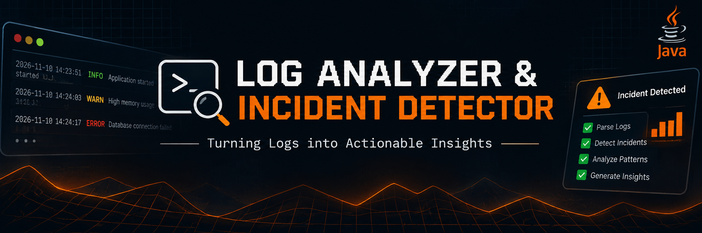
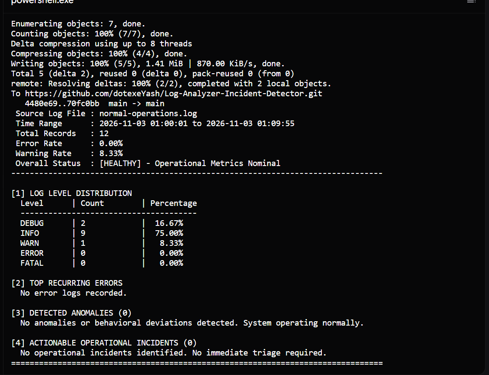
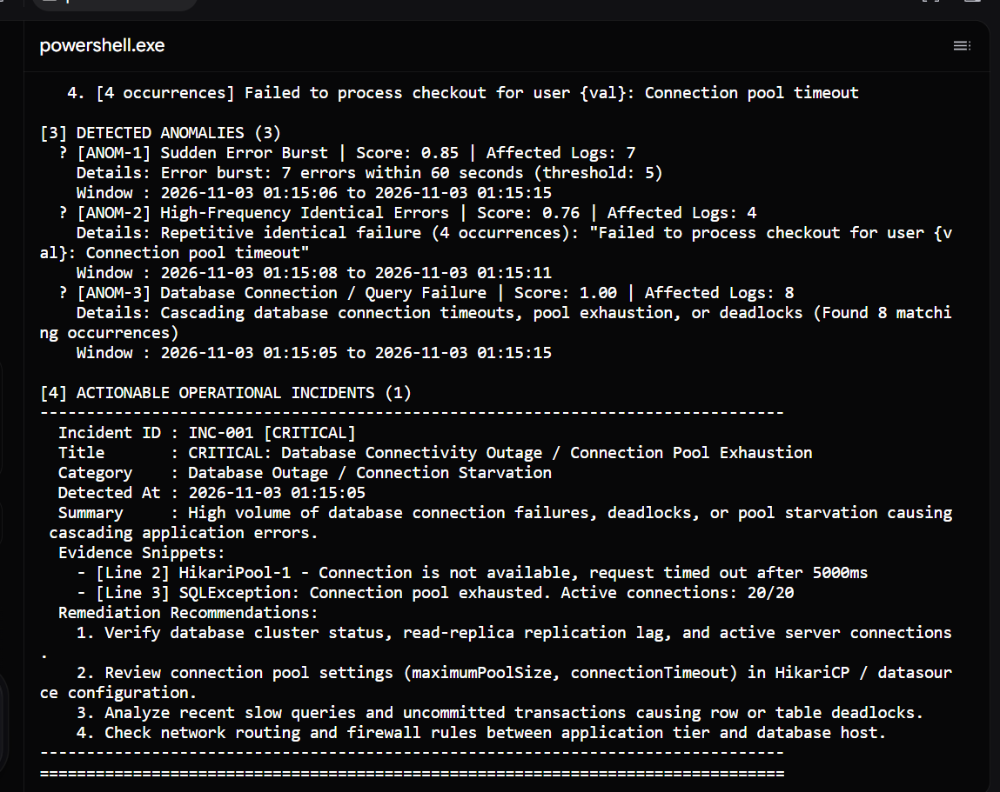
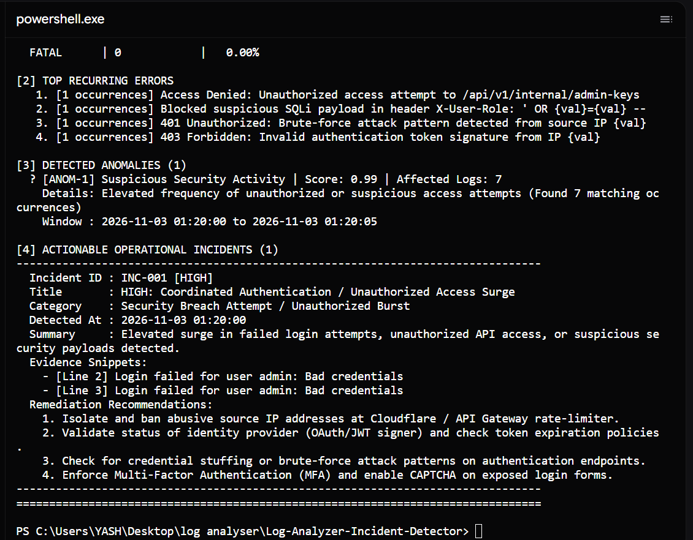
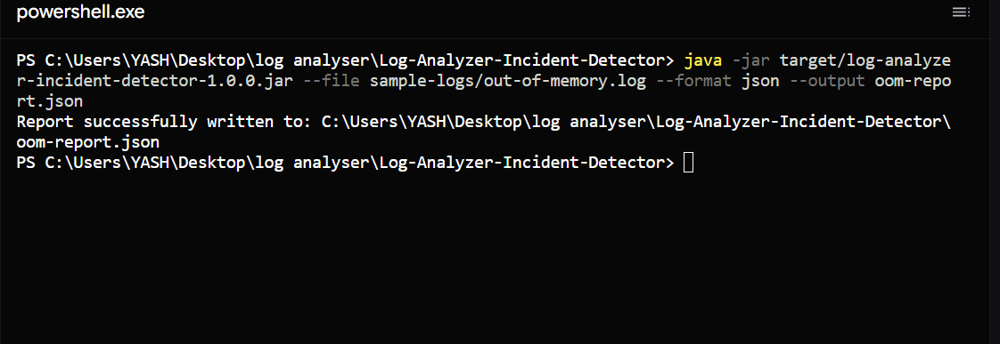
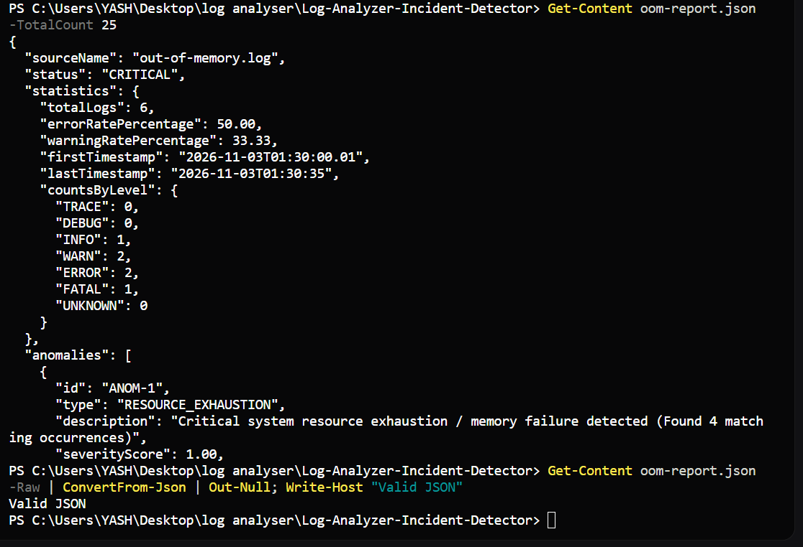
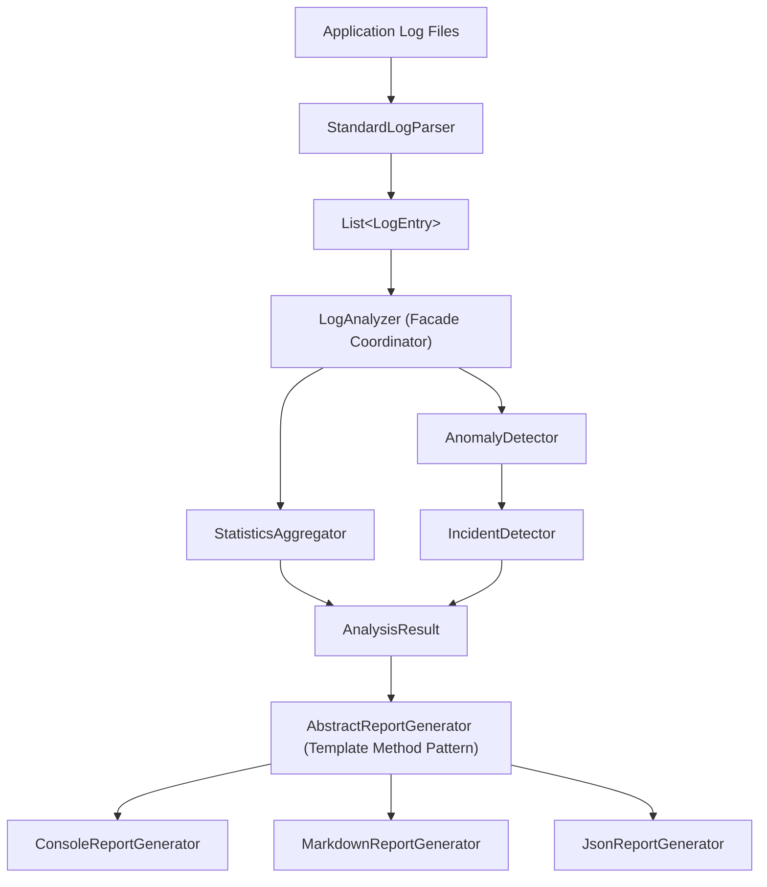

# 🔍 Log Analyzer & Incident Detector

<p align="center">
  
</p>


**Turn raw application logs into actionable operational insights using Java 21.**

A modular Java application that analyzes application logs, detects anomalous patterns, identifies critical operational incidents, and generates detailed reports with actionable remediation recommendations.

---

## 📌 Overview

Application logs contain valuable telemetry regarding system health, operational failures, and security events. However, identifying meaningful patterns across thousands of log entries is challenging during live incidents.

**Log Analyzer & Incident Detector** automates this triage workflow by:

* **Parsing** application log files, extracting timestamps, thread IDs, loggers, log levels, and multiline stack traces.
* **Aggregating** statistics including log level distributions, error/warning rates, and normalized recurring error frequencies.
* **Detecting** anomalous behavioral patterns such as sliding-window error bursts, database failures, resource exhaustion, and security attack signatures.
* **Categorizing** anomalies into prioritized operational incidents with deterministic severity assignment.
* **Providing** forensic log evidence and actionable remediation steps for on-call engineers.
* **Generating** reports across multiple formats (terminal Console, Markdown, and JSON).

---

## ✨ Key Features

### 1. Robust Log Parsing
* Parses standard Spring Boot / Logback patterns and bracketed timestamp formats.
* Supports ISO-8601 timestamps and custom datetime patterns with strict calendar-date validation (`ResolverStyle.STRICT`).
* Automatically associates multiline stack traces and root causes (`Caused by:`) with their parent log entries.
* Gracefully handles malformed, unformatted, or corrupted lines without interrupting log file processing.

### 2. Statistical Analysis & Error Aggregation
* Classifies standard logging levels: `TRACE`, `DEBUG`, `INFO`, `WARN`, `ERROR`, and `FATAL`.
* Computes overall error and warning percentages against total log volume.
* Normalizes dynamic identifiers (UUIDs, timestamps, hex addresses, numeric IDs) using context-aware regex patterns to group identical root causes.
* Utilizes a type-safe generic frequency distribution container (`FrequencyDistribution<T>`) for flexible metric collection.

### 3. Anomaly Detection Engine
| Anomaly Type | Description |
| :--- | :--- |
| **Error Burst** | Detects high-frequency error bursts within a configurable sliding time window (default: 5 errors in 60s). |
| **Repeated Failures** | Identifies identical recurring exceptions exceeding frequency thresholds. |
| **Memory Exhaustion** | Detects JVM `OutOfMemoryError`, heap space exhaustion, and GC overhead limit conditions. |
| **Security Activity** | Identifies authentication failures, brute-force attempts, unauthorized access, and SQL injection patterns. |
| **Database Failures** | Detects connection pool exhaustion (e.g., HikariCP timeouts), deadlocks, and SQL exceptions. |
| **Network Degradation** | Identifies connection timeouts, socket timeouts, 504 gateway timeouts, and refused connections. |

### 4. Incident Detection & Prioritization
Detected anomalies are correlated and mapped into prioritized operational incidents with four severity tiers:
* 🔴 `CRITICAL` — Catastrophic outages requiring immediate intervention (e.g., JVM crashes, DB connection exhaustion).
* 🟠 `HIGH` — Serious operational or security degradation (e.g., repeated authentication attacks, error bursts).
* 🟡 `MEDIUM` — Significant resource warnings or repetitive non-fatal errors.
* 🟢 `LOW` — Minor service degradation or routine operational warnings.

**Incident Categories:**
* `MEMORY_CRITICAL_FAILURE`
* `DATABASE_OUTAGE`
* `SECURITY_BREACH_ATTEMPT`
* `NETWORK_SERVICE_DEGRADATION`
* `APPLICATION_CRASH`
* `GENERAL_INCIDENT`

Each incident provides the root cause anomaly, triggering criteria, contextual timestamp boundaries, log evidence count, and structured remediation recommendations.

### 5. Multi-Format Report Generation
* **Console Dashboard:** Rich terminal report designed for instant human inspection during live operational triage.
* **Markdown (`.md`):** Formatted documentation with severity indicators, tables, and code fences for post-mortem incident reports.
* **JSON (`.json`):** Machine-readable, locale-independent (`Locale.ROOT`) structured payload for ingestion into SIEMs, dashboards, or CI/CD pipelines.

---

## 📸 Application Screenshots

Visual demonstration of the Log Analyzer and Incident Detector CLI processing operational log scenarios and generating multi-format reports:

### 1. Normal Operations
Terminal dashboard showing clean analysis of routine HTTP operations with 0 anomalies and 0 incidents detected:



### 2. Critical Database Incident
Detection of database connection pool exhaustion (HikariCP timeout) classified as a `CRITICAL` operational incident with remediation recommendations:



### 3. Security Attack Detection
Detection of repeated authentication failures, brute-force access attempts, and SQL injection patterns classified as `HIGH` severity:



### 4. JSON Report Generation
Execution of the CLI command generating a machine-readable JSON report saved to disk:



### 5. Generated JSON Report Preview
Structured JSON report payload containing detailed metadata, level distributions, detected anomalies, and categorized incidents:



---

## 🛠️ Technologies Used

* **Java 21 (LTS):** Built using modern Java features including:
  * **Records:** Immutable configuration record (`CliConfig`).
  * **Switch Expressions:** Clean, expressive arrow-syntax dispatching across log levels, CLI options, and report formats.
  * **Text Blocks:** Multi-line report templates and CLI documentation.
  * **Modern Date/Time API (`java.time`):** Microsecond timestamp resolution and strict calendar validation (`ResolverStyle.STRICT`).
  * **Stream API & Functional Pipelines:** Declarative anomaly filtering and statistical aggregation.
* **Apache Maven:** Dependency management, compiler lifecycle configuration (`release 21`), and automated test execution via `maven-surefire-plugin`.
* **JUnit 5 (Jupiter 5.10.2):** Comprehensive test framework leveraging `@Test`, `@ParameterizedTest`, `@ValueSource`, `@TempDir`, and robust lifecycle assertions (`assertNotNull`, `assertSame`, `assertThrows`).
* **Git & GitHub:** Version control, atomic commits, and documentation traceability.
* **Zero External Runtime Dependencies:** Implemented exclusively with standard Java 21 platform libraries (`java.nio.file`, `java.time`, `java.util.regex`), ensuring minimal attack surface, instant startup, and zero dependency conflicts.

---

## 🏗️ Architecture & OOP Design

The application follows clean object-oriented architecture, applying design patterns for modularity and testability:



### Key Design Patterns & Principles
* **Facade Pattern (`LogAnalyzer`):** Provides a unified entry point that orchestrates parsing, statistical aggregation, anomaly detection, and incident categorization.
* **Template Method Pattern (`AbstractReportGenerator`):** Standardizes common report generation steps while allowing format-specific renderers to implement concrete presentation logic.
* **Inversion of Control & Dependency Injection:** Core components (`LogAnalyzer`, `AnomalyDetector`) feature flexible constructor injection, allowing custom aggregators, parsers, and thresholds to be injected seamlessly.
* **Generics & Data Structure Decoupling (`FrequencyDistribution<T>`):** Reusable, type-safe frequency container for counting and querying occurrences of arbitrary keys.
* **Defensive Immutability:** Model classes (`LogEntry`, `Anomaly`, `Incident`, `AnalysisResult`) encapsulate unmodifiable collections and enforce non-null invariants.

---

## 📂 Project Structure

```text
Log-Analyzer-Incident-Detector/
│
├── pom.xml                                     # Maven build & JUnit 5 configuration
├── README.md                                   # Comprehensive project documentation
├── .gitignore                                  # Git exclusion rules
│
├── docs/                                       # Engineering & audit documentation
│   └── development-reports/
│       ├── Phase-1/                            # Phase 1: Bug Fixes & Code Quality
│       │   ├── Task-1/                         # Security anomaly false-positive fixes
│       │   ├── Task-2/                         # Error burst sliding window & precision
│       │   ├── Task-3/                         # Decoupled CLI argument validation
│       │   ├── Task-4/                         # Context-aware digit normalization
│       │   ├── Task-5/                         # Strict calendar timestamp parsing
│       │   ├── Task-6/                         # Exception handling & defensive safety
│       │   └── Milestone-Review/               # Phase 1 milestone code review & diffs
│       ├── Phase-2/                            # Phase 2: OOP Strengthening
│       │   ├── OOP-ARCHITECTURE-AUDIT-REPORT.md
│       │   ├── TASK-1-ABSTRACT-REPORT-GENERATOR-IMPLEMENTATION-REPORT.md
│       │   ├── Task-1/                         # AbstractReportGenerator review
│       │   ├── Task-2/                         # Generic FrequencyDistribution<T>
│       │   └── Task-3/                         # Constructor Dependency Injection
│       └── Phase-3/                            # Phase 3: Testing & Quality Assurance
│           ├── Task-1/                         # Project-wide audit report
│           ├── Task-2/                         # Locale-independent JSON formatting
│           ├── Task-3/                         # IncidentDetector unit test suite
│           ├── Task-4/                         # Parsing edge cases & timestamp sort fix
│           ├── Task-5/                         # LogAnalyzer constructor chaining
│           └── CLI-EXIT-CODE-REPORT.md         # CLI exit-code investigation & Option A
│
├── assets/                                     # Project media & documentation assets
│   ├── project-banner.png                      # Repository banner image
│   └── screenshots/                            # Application execution screenshots
│
├── sample-logs/                                # Realistic operational evaluation logs
│   ├── normal-operations.log                  # Baseline healthy HTTP traffic
│   ├── critical-incident-database.log          # HikariCP pool exhaustion & outage
│   ├── security-attack.log                     # Auth brute-force & SQL injection
│   └── out-of-memory.log                       # JVM OutOfMemoryError fatal crash
│
└── src/
    ├── main/
    │   ├── java/com/loganalyzer/
    │   │   ├── Main.java                       # CLI entry point & argument parsing
    │   │   ├── analyzer/                       # LogAnalyzer, AnomalyDetector, IncidentDetector
    │   │   ├── exception/                      # Domain exceptions (InvalidLogFileException)
    │   │   ├── model/                          # Domain models (LogEntry, Anomaly, Incident)
    │   │   ├── parser/                         # StandardLogParser & timestamp parsing
    │   │   ├── report/                         # AbstractReportGenerator & format renderers
    │   │   └── util/                           # FrequencyDistribution<T> container
    │   │
    │   └── resources/
    │       └── sample-logs/                    # Bundled fallback classpath resources
    │
    └── test/
        └── java/com/loganalyzer/
            ├── MainCliTest.java                # CLI argument parsing & validation tests
            ├── analyzer/                       # Anomaly, incident, analyzer & stats unit tests
            ├── integration/                    # Multi-scenario end-to-end integration tests
            ├── parser/                         # Log parsing, multiline & edge-case tests
            ├── report/                         # Console, Markdown & JSON report tests
            └── util/                           # Generic FrequencyDistribution tests
```

---

## 🚀 Development Phases

The project was developed in three systematic, documented engineering phases:

### Phase 1: Bug Fixes & Code Quality (6 Tasks)
* [**Task 1: Security Anomaly Filtering**](docs/development-reports/Phase-1/Task-1/TASK-1-SECURITY-FIX-REPORT.md) — Eliminated false positives in security anomaly detection by restricting pattern matching to appropriate log levels and adding negative test cases.
* [**Task 2: Error Burst Sliding Window**](docs/development-reports/Phase-1/Task-2/TASK-2-IMPLEMENTATION-REPORT.md) — Implemented sub-second precision boundary handling, chronological sorting, and sliding window verification.
* [**Task 3: Decoupled CLI Argument Parser**](docs/development-reports/Phase-1/Task-3/TASK-3-CLI-VALIDATION-IMPLEMENTATION-REPORT.md) — Built a robust argument parser supporting POSIX and GNU-style options with strict input validation.
* [**Task 4: Context-Aware Digit Normalization**](docs/development-reports/Phase-1/Task-4/TASK-4-DIGIT-NORMALIZATION-IMPLEMENTATION-REPORT.md) — Replaced greedy regex substitutions with context-sensitive token replacement to group recurring errors accurately.
* [**Task 5: Strict Calendar Timestamp Parsing**](docs/development-reports/Phase-1/Task-5/TASK-5-FINAL-INSPECTION-AND-IMPLEMENTATION-REPORT.md) — Enforced `ResolverStyle.STRICT` across multi-format datetime patterns to reject impossible dates (e.g., February 30).
* [**Task 6: Project-Wide Exception Handling**](docs/development-reports/Phase-1/Task-6/TASK-6-EXCEPTION-HANDLING-IMPLEMENTATION-REPORT.md) — Hardened custom exception hierarchies, defensive null safety, and clean exception chaining.
* [**Phase 1 Milestone Review**](docs/development-reports/Phase-1/Milestone-Review/TASK-5-6-FINAL-CODE-REVIEW.md) — Consolidated architectural review and documentation structure audit.

### Phase 2: OOP Strengthening (3 Tasks)
* [**OOP Architecture Audit**](docs/development-reports/Phase-2/OOP-ARCHITECTURE-AUDIT-REPORT.md) — Architectural assessment identifying OOP refactoring opportunities.
* [**Task 1: Abstract Report Generator**](docs/development-reports/Phase-2/TASK-1-ABSTRACT-REPORT-GENERATOR-IMPLEMENTATION-REPORT.md) — Introduced `AbstractReportGenerator` implementing the Template Method pattern to eliminate code duplication across report generators.
* [**Task 2: Generic Statistics Collection**](docs/development-reports/Phase-2/Task-2/IMPLEMENTATION-REPORT.md) — Created `FrequencyDistribution<T>`, a generic container replacing raw maps and decoupling statistical counting logic.
* [**Task 3: Constructor Dependency Injection**](docs/development-reports/Phase-2/Task-3/IMPLEMENTATION-REPORT.md) — Implemented constructor-based dependency injection and shared state management between `LogAnalyzer` and `AnomalyDetector`.

### Phase 3: Testing & Final Quality Assurance (6 Tasks)
* [**Task 1: Comprehensive Project Audit**](docs/development-reports/Phase-3/Task-1/PROJECT-AUDIT.md) — Read-only audit across packages, Maven configuration, test coverage, and edge cases.
* [**Task 2: Locale-Independent JSON Formatting**](docs/development-reports/Phase-3/Task-2/IMPLEMENTATION-REPORT.md) — Fixed locale-dependent floating-point numbers in `JsonReportGenerator` using `Locale.ROOT` and regression testing.
* [**Task 3: IncidentDetector Test Expansion**](docs/development-reports/Phase-3/Task-3/IMPLEMENTATION-REPORT.md) — Added unit tests covering all incident categories (`SECURITY_BREACH_ATTEMPT`, `NETWORK_SERVICE_DEGRADATION`, `APPLICATION_CRASH`, `GENERAL_INCIDENT`).
* [**Task 4: Edge-Case Testing & Timestamp Sort Fix**](docs/development-reports/Phase-3/Task-4/IMPLEMENTATION-REPORT.md) — Added edge-case test suites (zero-byte files, whitespace-only files, corrupted logs) and corrected timestamp range calculation for out-of-order logs in `AnomalyDetector`.
* [**Task 5: Constructor Chaining & Encapsulation**](docs/development-reports/Phase-3/Task-5/CODE-QUALITY-REPORT.md) — Refactored `LogAnalyzer` constructor chaining to eliminate duplicate fallback instances and encapsulated internal accessors as package-private.
* [**Task 6: CLI Exit-Code Behavior & Specification Clarification**](docs/development-reports/Phase-3/CLI-EXIT-CODE-REPORT.md) — Conducted read-only investigation and clarified CLI help and documentation to distinguish single-file analysis from showcase demo mode.

---

## ⚙️ Prerequisites

* **Java Development Kit (JDK):** Version 21 or higher
* **Apache Maven:** Version 3.8 or higher
* **Git:** For source code control

Verify your local environment:
```bash
java -version
mvn -version
git --version
```

---

## 🏁 Getting Started

### 1. Clone the Repository
```bash
git clone https://github.com/dotexeYash/Log-Analyzer-Incident-Detector.git
cd Log-Analyzer-Incident-Detector
```

### 2. Build and Package
```bash
mvn clean package
```
This compiles the code, executes the automated test suite (144 tests), and produces the executable JAR:
`target/log-analyzer-incident-detector-1.0.0.jar`.

### 3. Run the Demonstration Suite
```bash
java -jar target/log-analyzer-incident-detector-1.0.0.jar --demo
```

---

## 💻 Usage Examples

### 1. Run Demonstration Mode
Analyzes all bundled sample scenarios back-to-back:
```bash
java -jar target/log-analyzer-incident-detector-1.0.0.jar --demo
```

### 2. Analyze a Specific Log File
```bash
java -jar target/log-analyzer-incident-detector-1.0.0.jar -f sample-logs/critical-incident-database.log
```

### 3. Generate a Markdown Incident Report
```bash
java -jar target/log-analyzer-incident-detector-1.0.0.jar -f sample-logs/security-attack.log -fmt markdown -o security-report.md
```

### 4. Generate a Machine-Readable JSON Report
```bash
java -jar target/log-analyzer-incident-detector-1.0.0.jar -f sample-logs/out-of-memory.log -fmt json -o oom-report.json
```

### 5. Customize Anomaly Detection Thresholds
Configure custom sliding-window error burst parameters:
```bash
java -jar target/log-analyzer-incident-detector-1.0.0.jar -f sample-logs/security-attack.log -b 10 -w 120
```
* `-b 10` — Trigger error burst anomaly upon 10 errors.
* `-w 120` — Set sliding detection window to 120 seconds.

---

## 📖 Command-Line Reference

| Option | Short Flag | Description | Default |
| :--- | :--- | :--- | :--- |
| `--file <path>` | `-f` | Path to target log file to inspect | Required (unless in demo mode) |
| `--format <type>` | `-fmt` | Output format: `console`, `markdown` (`md`), `json` | `console` |
| `--output <path>` | `-o` | Destination file path to save report | Standard output |
| `--burst-threshold <n>`| `-b` | Consecutive error burst threshold | `5` |
| `--window <seconds>` | `-w` | Burst detection time window in seconds | `60` |
| `--demo` | — | Execute demonstration against bundled scenarios | `false` |
| `--help` | `-h` | Display usage instructions and exit | — |

### Exit Codes

#### Single-File Analysis (`-f` / `--file`)
| Code | Meaning |
| :---: | :--- |
| **`0`** | Analysis completed successfully without critical incidents. |
| **`1`** | Invalid arguments, unreadable file, or execution error. |
| **`2`** | One or more **`CRITICAL`** operational incidents detected (e.g., JVM crashes, DB connection pool outages). |

#### Demonstration Mode (`--demo`)
| Code | Meaning |
| :---: | :--- |
| **`0`** | Demonstration suite finished execution successfully, even if individual sample scenarios detect critical incidents. |
| **`1`** | Execution error occurred during the demonstration suite. |

---

## 🧪 Testing & Verification

The project enforces quality assurance through unit tests, parameterized tests, boundary tests, and end-to-end integration workflows.

### Test Coverage Areas
* **Log Parsing:** ISO-8601, custom timestamp patterns, multiline exception stack traces, zero-byte files, corrupted lines.
* **Timestamp Handling:** Strict calendar resolution (`ResolverStyle.STRICT`), out-of-order timestamp sorting.
* **Anomaly Detection:** Error bursts, repeated exceptions, memory exhaustion, security breaches, DB failures, timeouts.
* **Incident Detection:** Severity classification, category mapping, recommendation generation.
* **Reporting:** Console ANSI formatting, Markdown table generation, locale-independent JSON serialization.
* **Architecture:** Full constructor dependency injection, single-instance sharing, encapsulation.

### Run Automated Tests
```bash
mvn test
```

### Verified Test Suite Results
```
[INFO] Results:
[INFO]
[INFO] Tests run: 144, Failures: 0, Errors: 0, Skipped: 0
[INFO]
[INFO] ------------------------------------------------------------------------
[INFO] BUILD SUCCESS
[INFO] ------------------------------------------------------------------------
```

| Metric | Result |
| :--- | :---: |
| **Total Tests Executed** | **144** |
| **Failures** | **0** |
| **Errors** | **0** |
| **Skipped** | **0** |
| **Build Status** | **SUCCESS** |

### Test Breakdown by Suite
| Test Class | Package | Tests Run | Status |
| :--- | :--- | :---: | :---: |
| `AnomalyDetectorTest` | `com.loganalyzer.analyzer` | 29 | PASSED |
| `IncidentDetectorTest` | `com.loganalyzer.analyzer` | 12 | PASSED |
| `LogAnalyzerTest` | `com.loganalyzer.analyzer` | 7 | PASSED |
| `StatisticsAggregatorTest` | `com.loganalyzer.analyzer` | 11 | PASSED |
| `LogAnalyzerEndToEndTest` | `com.loganalyzer.integration` | 11 | PASSED |
| `MainCliTest` | `com.loganalyzer` | 31 | PASSED |
| `StandardLogParserTest` | `com.loganalyzer.parser` | 22 | PASSED |
| `ReportGeneratorTest` | `com.loganalyzer.report` | 12 | PASSED |
| `FrequencyDistributionTest` | `com.loganalyzer.util` | 9 | PASSED |
| **Total** | | **144** | **100% Passing** |

---

## 🔮 Future Improvements

* Add a web-based graphical user interface dashboard.
* Support real-time log tailing and streaming via WebSockets.
* Introduce configurable alerting webhooks (Slack, PagerDuty, Email).
* Support additional distributed log formats (e.g., JSON log lines, syslog RFC 5424).
* Add performance benchmarking and optimization for multi-gigabyte log archives.

---

## 👨‍💻 Author

**Yash Lowanshi**<br>
B.Tech — Computer Science and Engineering<br>
GitHub: [@dotexeYash](https://github.com/dotexeYash)

---

*Built with Java 21, Apache Maven, and JUnit 5.*
