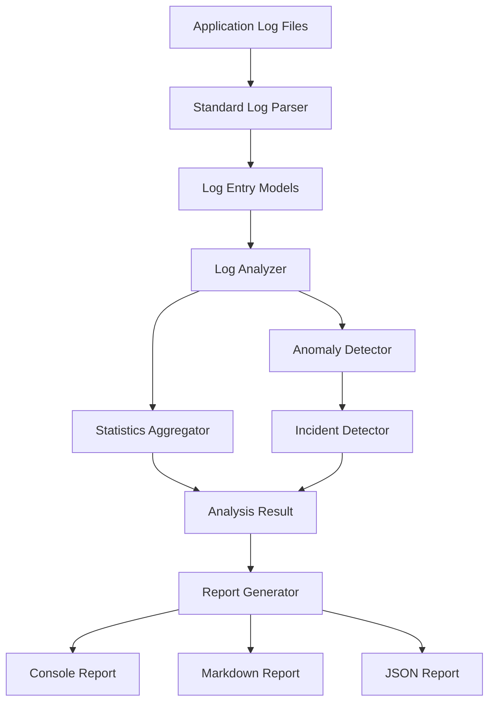

# 🔍 Log Analyzer & Incident Detector

**Turn raw application logs into actionable operational insights using Java 21.**

A modular Java application that analyzes application logs, detects anomalous patterns, identifies critical operational incidents, and generates detailed reports with actionable remediation recommendations.


\

---

## 📌 Overview

Application logs contain valuable information about system health, failures, and security events. However, identifying meaningful patterns across multiple log entries can be difficult.

**Log Analyzer & Incident Detector** automates this process by:

* Parsing application log files.
* Analyzing errors, warnings, and recurring failures.
* Detecting unusual activity and error bursts.
* Identifying memory, database, and security-related incidents.
* Assigning incident severity levels.
* Providing evidence and remediation recommendations.
* Generating reports in multiple formats.

---

## ✨ Key Features

### 1. Log Parsing

* Supports standard Spring/Logback and bracketed log formats.
* Handles ISO-8601 and other supported timestamp formats.
* Associates multiline stack traces with their parent log entries.
* Handles malformed or unformatted lines without stopping the entire analysis.

### 2. Error & Warning Analysis

* Classifies `TRACE`, `DEBUG`, `INFO`, `WARN`, `ERROR`, and `FATAL` log levels.
* Calculates error and warning percentages.
* Identifies frequently recurring errors.
* Normalizes dynamic identifiers to group similar failures.

### 3. Anomaly Detection

| Anomaly             | Description                                                                                     |
| ------------------- | ----------------------------------------------------------------------------------------------- |
| Error Burst         | Detects unusually high error frequency within a configurable time window.                       |
| Repeated Failures   | Identifies recurring exceptions and failure patterns.                                           |
| Memory Exhaustion   | Detects JVM Out Of Memory Error and GC overhead issues.                                         |
| Security Activity   | Identifies suspicious authentication failures, unauthorized access, and SQL injection patterns. |
| Database Failures   | Detects connection pool exhaustion, SQL exceptions, and deadlocks.                              |
| Network Degradation | Identifies connection failures, socket timeouts, and gateway errors.                            |

### 4. Incident Detection & Prioritization

Detected anomalies are translated into actionable operational incidents.

**Severity levels:**

* 🔴 `CRITICAL`
* 🟠 `HIGH`
* 🟡 `MEDIUM`
* 🟢 `LOW`

**Incident categories include:**

* `MEMORY_CRITICAL_FAILURE`
* `DATABASE_OUTAGE`
* `SECURITY_BREACH_ATTEMPT`
* `NETWORK_SERVICE_DEGRADATION`
* `APPLICATION_CRASH`

Each incident includes supporting log evidence and remediation recommendations.

### 5. Multi-Format Reporting

| Format   | Purpose                                      |
| -------- | -------------------------------------------- |
| Console  | Terminal-based analysis dashboard            |
| Markdown | Readable incident documentation              |
| JSON     | Structured machine-readable analysis results |

---

## 🏗️ Architecture

The application follows a modular architecture with separate components for parsing, analysis, incident detection, and report generation.



### Main Components

| Component                 | Responsibility                                  |
| ------------------------- | ----------------------------------------------- |
| `StandardLogParser`       | Parses log records and multiline stack traces.  |
| `LogAnalyzer`             | Coordinates the analysis workflow.              |
| `StatisticsAggregator`    | Calculates log statistics and recurring errors. |
| `AnomalyDetector`         | Identifies unusual log patterns and bursts.     |
| `IncidentDetector`        | Categorizes incidents and assigns severity.     |
| `ConsoleReportGenerator`  | Generates terminal reports.                     |
| `MarkdownReportGenerator` | Generates Markdown reports.                     |
| `JsonReportGenerator`     | Generates JSON reports.                         |

---

## 📂 Project Structure

```text
Log-Analyzer-Incident-Detector/
│
├── .gitignore
├── pom.xml
├── README.md
│
├── docs/
│   └── development-reports/
│       └── Phase-1/
│           ├── Task-1/
│           ├── Task-2/
│           ├── Task-3/
│           ├── Task-4/
│           ├── Task-5/
│           ├── Task-6/
│           └── Milestone-Review/
│
├── sample-logs/
│   ├── normal-operations.log
│   ├── critical-incident-database.log
│   ├── security-attack.log
│   └── out-of-memory.log
│
└── src/
    ├── main/
    │   ├── java/com/loganalyzer/
    │   │   ├── Main.java
    │   │   ├── analyzer/
    │   │   ├── exception/
    │   │   ├── model/
    │   │   ├── parser/
    │   │   └── report/
    │   │
    │   └── resources/
    │       └── sample-logs/
    │
    └── test/
        └── java/com/loganalyzer/
            ├── analyzer/
            ├── integration/
            ├── parser/
            └── report/
```

---

## 📚 Documentation

Phase 1 development reports, technical investigations, and architectural reviews are available inside [`docs/development-reports/Phase-1/`](docs/development-reports/Phase-1/):

* [**Task 1**](docs/development-reports/Phase-1/Task-1/) — Fix false-positive security anomaly filtering and test suite additions.
* [**Task 2**](docs/development-reports/Phase-1/Task-2/) — Error burst sliding window detection, sub-second precision boundary fix, and timestamp sorting integrity.
* [**Task 3**](docs/development-reports/Phase-1/Task-3/) — Decoupled CLI argument parser, strict option validation, and reference implementation.
* [**Task 4**](docs/development-reports/Phase-1/Task-4/) — Context-aware digit normalization, regex refinement, and regression testing.
* [**Task 5**](docs/development-reports/Phase-1/Task-5/) — Multi-format timestamp parsing, timezone offset handling, and strict calendar-date validation (`ResolverStyle.STRICT`).
* [**Task 6**](docs/development-reports/Phase-1/Task-6/) — Project-wide exception handling audit, custom exception serialization, and defensive null handling.
* [**Milestone-Review**](docs/development-reports/Phase-1/Milestone-Review/) — Consolidated Phase 1 code review, complete source diffs (Markdown & text), and documentation structure records.

Each task folder contains its corresponding investigation, design, implementation, and test verification reports. The `Milestone-Review` folder contains combined code reviews and milestone artifacts across tasks.

---

## ⚙️ Prerequisites

Make sure you have the following installed:

* **Java Development Kit:** JDK 21 or higher
* **Apache Maven:** 3.8 or higher
* **Git:** For cloning the repository

Verify your installations:

```bash
java -version
mvn -version
git --version
```

---

## 🚀 Getting Started

### 1. Clone the Repository

```bash
git clone https://github.com/dotexeYash/Log-Analyzer-Incident-Detector.git
```

### 2. Navigate to the Project

```bash
cd Log-Analyzer-Incident-Detector
```

### 3. Build the Application

```bash
mvn clean package
```

This compiles the project, executes the automated tests, and packages the application into an executable JAR.

### 4. Run the Application

```bash
java -jar target/log-analyzer-incident-detector-1.0.0.jar --demo
```

---

## 💻 Usage Examples

### 1. Run Demonstration Mode

Analyze the bundled sample scenarios:

```bash
java -jar target/log-analyzer-incident-detector-1.0.0.jar --demo
```

### 2. Analyze a Specific Log File

```bash
java -jar target/log-analyzer-incident-detector-1.0.0.jar -f sample-logs/critical-incident-database.log
```

### 3. Generate a Markdown Report

```bash
java -jar target/log-analyzer-incident-detector-1.0.0.jar -f sample-logs/security-attack.log -fmt markdown -o security-report.md
```

### 4. Generate a JSON Report

```bash
java -jar target/log-analyzer-incident-detector-1.0.0.jar -f sample-logs/out-of-memory.log -fmt json -o oom-report.json
```

### 5. Configure Anomaly Detection Thresholds

Customize the error burst threshold and detection window:

```bash
java -jar target/log-analyzer-incident-detector-1.0.0.jar -f sample-logs/security-attack.log -b 10 -w 120
```

Example:

* `-b 10` — Set the error burst threshold to 10.
* `-w 120` — Set the detection window to 120 seconds.

---

## 📖 Command-Line Reference

| Option                  | Short Flag | Description                            | Default                   |
| ----------------------- | ---------- | -------------------------------------- | ------------------------- |
| `--file <path>`         | `-f`       | Input log file                         | Required unless demo mode |
| `--format <type>`       | `-fmt`     | Output format: `console`, `md`, `json` | `console`                 |
| `--output <path>`       | `-o`       | Save report to a file                  | Standard output           |
| `--burst-threshold <n>` | `-b`       | Error burst threshold                  | `5`                       |
| `--window <seconds>`    | `-w`       | Burst detection time window            | `60`                      |
| `--demo`                | —          | Run bundled demonstration scenarios    | `false`                   |
| `--help`                | `-h`       | Display usage instructions             | —                         |

**Supported report formats:** `console`, `md`, and `json`. The `markdown` format name is also supported.

### Exit Codes

| Code | Meaning                                              |
| ---- | ---------------------------------------------------- |
| `0`  | Analysis completed without critical issues.          |
| `1`  | Invalid arguments, input, or execution error.        |
| `2`  | One or more critical operational incidents detected. |

---

## 🧪 Testing

The project includes unit and integration tests covering the major application components.

### Test Coverage Areas

* Standard and multiline log parsing.
* Timestamp format handling.
* Sliding-window error burst detection.
* Security threat identification.
* JVM resource exhaustion detection.
* Database connection pool failure detection.
* Incident categorization and recommendations.
* Console, Markdown, and JSON report generation.
* End-to-end analysis workflows.

### Run the Tests

```bash
mvn test
```

### Verified Test Results

The project has successfully completed its current automated test suite.

| Metric         |  Result |
| -------------- | ------: |
| Tests executed |      23 |
| Failures       |       0 |
| Errors         |       0 |
| Skipped        |       0 |
| Build status   | SUCCESS |

### Manual Verification

The following scenarios have also been manually tested:

| Scenario                           | Observed Result                                                    |
| ---------------------------------- | ------------------------------------------------------------------ |
| Normal application logs            | Classified as healthy, with no anomalies or incidents.             |
| JVM memory exhaustion              | Critical memory incident detected.                                 |
| Suspicious authentication activity | High-severity security incident detected.                          |
| Database connection failures       | Critical database outage detected.                                 |
| Custom error burst threshold       | Detection behavior changed as expected when the threshold changed. |
| Markdown report generation         | Report successfully generated.                                     |
| JSON report generation             | Report successfully generated and parsed as valid JSON.            |

---

## 🔮 Future Improvements

Potential areas for further development:

* Add a graphical dashboard for log analysis.
* Support additional log formats and configurable parsing rules.
* Introduce real-time log monitoring.
* Add configurable alerting and notification integrations.
* Add more extensive performance and large-file testing.
* Support additional report formats and integrations.

---

## 👨‍💻 Author

**Yash Lowanshi**

B.Tech — Computer Science and Engineering

GitHub: [@dotexeYash](https://github.com/dotexeYash)

---

*Built with Java 21 and Apache Maven.*
