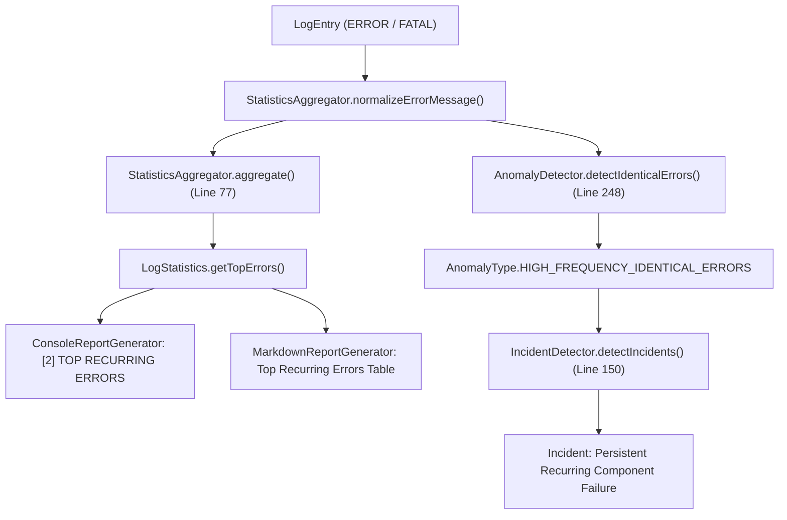

# 🔬 Phase 1 – Task 4: Aggressive Digit Normalization Investigation Report

**Project:** Log Analyzer & Incident Detector (Java 21 / Maven)  
**Component Under Review:** `com.loganalyzer.analyzer.StatisticsAggregator.java` & Downstream Consumers  
**Subject:** Premature/Aggressive Numeric Value Replacement (`\b\d+\b` -> `{val}`), Status Code Erasure, and Erroneous Anomaly/Incident Grouping  
**Date:** November 6, 2026  
**Status:** 🔍 Investigation Complete (Pre-Implementation / Awaiting Review)  

---

## 1. Executive Summary

An in-depth code audit of `Log-Analyzer-Incident-Detector` confirms the user's suspicion: **the current normalization logic aggressively and indiscriminately replaces all numeric values (`\b\d+\b`) with `{val}`**.

This aggressive regex causes distinct HTTP status codes (such as `401 Unauthorized`, `403 Forbidden`, `500 Internal Server Error`, and `503 Service Unavailable`) to be stripped of their diagnostic meaning. When these codes appear in shared message templates (e.g., `Upstream request failed with status 401` vs `... status 500`), they normalize to identical strings (`Upstream request failed with status {val}`).

This produces three major system defects:
1. **False Anomaly Triggering:** `AnomalyDetector.detectIdenticalErrors()` misidentifies separate, heterogeneous HTTP errors as a single `HIGH_FREQUENCY_IDENTICAL_ERRORS` anomaly once the count reaches `identicalErrorThreshold` (4).
2. **False Operational Incident Creation:** `IncidentDetector.detectIncidents()` misclassifies these distinct failures as a single `INC-00X: Persistent Recurring Component Failure`.
3. **Severe Diagnostic Information Loss:** The top recurring error dashboards in console and markdown reports display unhelpful placeholders like `{val} Unauthorized` or `{val}.{val}.{val}.{val}` (mangled IPv4 octets), hiding whether errors stem from authentication, authorization, server crashes, or network timeouts.

---

## 2. Complete Log Normalization Implementation

The normalization logic is centralized in a single method and constant within [`StatisticsAggregator.java`](file:///c:/Users/YASH/Desktop/log%20analyser/Log-Analyzer-Incident-Detector/src/main/java/com/loganalyzer/analyzer/StatisticsAggregator.java):

### 2.1. Constant Definition ([Lines 24–26](file:///c:/Users/YASH/Desktop/log%20analyser/Log-Analyzer-Incident-Detector/src/main/java/com/loganalyzer/analyzer/StatisticsAggregator.java#L24-L26))
```java
    private static final Pattern DYNAMIC_VALUES_PATTERN = Pattern.compile(
            "\\b[0-9a-fA-F]{8}-[0-9a-fA-F]{4}-[0-9a-fA-F]{4}-[0-9a-fA-F]{4}-[0-9a-fA-F]{12}\\b|\\b0x[0-9a-fA-F]+\\b|\\b\\d+\\b"
    );
```

### 2.2. Normalization Method ([Lines 126–132](file:///c:/Users/YASH/Desktop/log%20analyser/Log-Analyzer-Incident-Detector/src/main/java/com/loganalyzer/analyzer/StatisticsAggregator.java#L126-L132))
```java
    /**
     * Normalizes error messages by replacing variable identifiers and numbers with placeholders.
     */
    public String normalizeErrorMessage(String message) {
        if (message == null || message.isBlank()) {
            return "Unspecified error";
        }
        String firstLine = message.lines().findFirst().orElse(message).trim();
        return DYNAMIC_VALUES_PATTERN.matcher(firstLine).replaceAll("{val}").trim();
    }
```

---

## 3. How and Where Numeric Values Are Normalized

`DYNAMIC_VALUES_PATTERN` is composed of three alternation branches:
1. `\b[0-9a-fA-F]{8}-[0-9a-fA-F]{4}-[0-9a-fA-F]{4}-[0-9a-fA-F]{4}-[0-9a-fA-F]{12}\b`: Matches standard 36-character UUIDs.
2. `\b0x[0-9a-fA-F]+\b`: Matches hexadecimal values and memory pointers.
3. `\b\d+\b`: **Matches any contiguous sequence of one or more decimal digits bounded by word boundaries (`\b`).**

Because branch (3) matches unconditionally:
* Every standalone number—whether it represents a taxonomic categorical status code (`401`, `500`), a network port (`80`, `443`, `5432`), an IP octet (`192`), or an exit code (`137`)—is replaced by `{val}`.
* Furthermore, because periods (`.`) in IPv4 addresses act as word boundaries in regex, `198.51.100.42` matches `\b\d+\b` four separate times, transforming into `{val}.{val}.{val}.{val}`.

---

## 4. Downstream Components Affected

`StatisticsAggregator.normalizeErrorMessage()` is consumed in two primary analysis pipelines, directly impacting statistics, anomaly detection, incident detection, and report generation:



### 4.1. Error Statistics & Top Recurring Errors
* **File:** `src/main/java/com/loganalyzer/analyzer/StatisticsAggregator.java` ([Lines 76–80](file:///c:/Users/YASH/Desktop/log%20analyser/Log-Analyzer-Incident-Detector/src/main/java/com/loganalyzer/analyzer/StatisticsAggregator.java#L76-L80))
* **Impact:** The normalized string is the key for `errorFrequency`. Colliding status codes combine into a single recurring bucket, distorting operational frequency metrics.
* **Reports:** Rendered in `ConsoleReportGenerator.java` (line 64) and `MarkdownReportGenerator.java` (line 76).

### 4.2. Anomaly Detection (`HIGH_FREQUENCY_IDENTICAL_ERRORS`)
* **File:** `src/main/java/com/loganalyzer/analyzer/AnomalyDetector.java` ([Lines 242–252](file:///c:/Users/YASH/Desktop/log%20analyser/Log-Analyzer-Incident-Detector/src/main/java/com/loganalyzer/analyzer/AnomalyDetector.java#L242-L252))
* **Impact:** `detectIdenticalErrors()` groups entries by `normalizeErrorMessage(entry.getMessage())`. If `group.getValue().size() >= identicalErrorThreshold` (default: 4), an anomaly is emitted. Distinct status codes sharing a sentence structure trigger false positive anomalies.

### 4.3. Operational Incident Synthesis
* **File:** `src/main/java/com/loganalyzer/analyzer/IncidentDetector.java` ([Lines 150–166](file:///c:/Users/YASH/Desktop/log%20analyser/Log-Analyzer-Incident-Detector/src/main/java/com/loganalyzer/analyzer/IncidentDetector.java#L150-L166))
* **Impact:** If `repetitiveAnomalies` contains anomalies and no specific crash/db/sec incidents took precedence, it generates:
  `INC-00X: Persistent Recurring Component Failure` ("A specific error condition is continuously repeating across the system").

---

## 5. Potential False Grouping & Loss of Critical Information

### Scenario A: HTTP Status Code Conflation (Client vs Server Failures)
Consider 4 log events from downstream API clients:
1. `2026-11-06 10:00:01 ERROR - Call to /v1/checkout failed with HTTP status 400`
2. `2026-11-06 10:00:02 ERROR - Call to /v1/checkout failed with HTTP status 401`
3. `2026-11-06 10:00:03 ERROR - Call to /v1/checkout failed with HTTP status 403`
4. `2026-11-06 10:00:04 ERROR - Call to /v1/checkout failed with HTTP status 500`

* **Current Normalization:**
  All four normalize to: `Call to /v1/checkout failed with HTTP status {val}`
* **Consequences:**
  * Frequency count = 4.
  * Triggers `HIGH_FREQUENCY_IDENTICAL_ERRORS` anomaly!
  * Falsely synthesized into `Persistent Recurring Component Failure` incident.
  * Triage confusion: Client bad requests (400) and auth failures (401/403) are grouped with internal server crashes (500).

### Scenario B: Diagnostic Masking on Standalone Status Codes
Consider standard server access/filter logs:
1. `401 Unauthorized: Expired bearer token` -> `{val} Unauthorized: Expired bearer token`
2. `403 Forbidden: Insufficient administrative privileges` -> `{val} Forbidden: Insufficient administrative privileges`
3. `500 Internal Server Error: NullPointerException in OrderService` -> `{val} Internal Server Error: NullPointerException in OrderService`

* **Consequences:**
  The numerical status code is destroyed. In generated executive summaries and markdown tables, SREs see `{val} Unauthorized`, which appears as an unrendered template bug.

### Scenario C: IPv4 Address Mangling
In `sample-logs/security-attack.log` (Line 5):
`401 Unauthorized: Brute-force attack pattern detected from source IP 198.51.100.42`
* **Current Normalization:**
  `{val} Unauthorized: Brute-force attack pattern detected from source IP {val}.{val}.{val}.{val}`
* **Consequences:**
  Each octet is matched separately by `\b\d+\b`.

### Scenario D: Port Numbers Masking Downstream Outages
1. `Connection refused to backend on port 80` (HTTP Web server)
2. `Connection refused to backend on port 443` (HTTPS API)
3. `Connection refused to backend on port 5432` (PostgreSQL Primary)
4. `Connection refused to backend on port 6379` (Redis Cache)

* **Current Normalization:**
  All four normalize to: `Connection refused to backend on port {val}` (count = 4).
* **Consequences:**
  The system reports a single repetitive component failure instead of revealing that four distinct infrastructure tiers are down simultaneously.

### Scenario E: Unix Exit Codes and Signals
* `Process exited with code 1` (Standard runtime exception)
* `Process exited with code 137` (SIGKILL / Out-Of-Memory termination)
* `Process exited with code 143` (SIGTERM / Graceful container stop)
* **Current Normalization:**
  All normalize to: `Process exited with code {val}`. SREs cannot detect OOM kills.

---

## 6. Proposed Minimal, Safe Fix

To eliminate false groupings while preserving backward compatibility (such as normalizing `order ID 12345` or `user 5510`), the normalization logic should differentiate between **Taxonomic / Categorical Status Codes** and **High-Cardinality Instance Variables**.

### 6.1. Strategy: Multi-Pattern Pre-Scrubbing & Status Code Preservation

1. **Full IPv4 Recognition:**
   Match complete IPv4 addresses as a single token (`\b(?:\d{1,3}\.){3}\d{1,3}\b`) before digit matching, normalizing them cleanly to `{val}`.
2. **Preserve HTTP Status Codes:**
   Protect standard 3-digit HTTP status codes (`100`–`599`, especially `4xx` and `5xx` error codes) when:
   * Preceded by HTTP indicators: `HTTP`, `HTTP/1.1`, `HTTP/2`, `status`, `status code`, `code`, `response` (e.g. `HTTP 401`, `status 500`, `code 403`).
   * Followed by standard HTTP reason phrases (e.g. `401 Unauthorized`, `403 Forbidden`, `404 Not Found`, `500 Internal Server Error`, `502 Bad Gateway`, `503 Service Unavailable`, `504 Gateway Timeout`).
   * Matching recognized RFC HTTP status codes (`400`, `401`, `403`, `404`, `405`, `408`, `409`, `422`, `429`, `500`, `502`, `503`, `504`).
3. **Normalize Remaining High-Cardinality Numbers:**
   Any remaining standalone numbers (e.g. `12345`, `67890`, `5510`) are replaced with `{val}`.

### 6.2. Proposed Architecture in `StatisticsAggregator.java`

```java
// 1. Full IPv4 addresses
private static final Pattern IPV4_PATTERN = Pattern.compile("\\b(?:\\d{1,3}\\.){3}\\d{1,3}\\b");

// 2. HTTP Status Code Protection: Matches HTTP status codes in standard contexts so they are preserved
private static final Pattern HTTP_STATUS_PROTECTED = Pattern.compile(
        "(?i)\\b(?:HTTP(?:/[0-9.]+)?\\s+|status(?:[ _-]?code)?\\s*[:=]?\\s*|code\\s*[:=]?\\s*)([1-5]\\d{2})\\b" +
        "|\\b(400|401|402|403|404|405|408|409|410|413|415|422|429|500|501|502|503|504|505)\\b" +
        "(?=\\s+(?:Unauthorized|Forbidden|Not Found|Internal Server Error|Bad Gateway|Service Unavailable|Gateway Timeout|Bad Request|Too Many Requests))"
);

// 3. Dynamic Identifiers (UUID, Hex, and Remaining Standalone Numbers)
private static final Pattern DYNAMIC_VALUES_PATTERN = Pattern.compile(
        "\\b[0-9a-fA-F]{8}-[0-9a-fA-F]{4}-[0-9a-fA-F]{4}-[0-9a-fA-F]{4}-[0-9a-fA-F]{12}\\b|\\b0x[0-9a-fA-F]+\\b|\\b\\d+\\b"
);
```

Or using an even cleaner Java tokenization approach:
Inspect each matched number: if it corresponds to an HTTP status code in context, leave it untouched; otherwise replace with `{val}`.

---

## 7. Community Wisdom Interlude

> [!NOTE]
> **Community Wisdom (dev.to / Observability Engineering Best Practices):**  
> In modern log clustering and template extraction architectures (such as Drain3, LenMa, and Vector log processing pipelines), production systems make a strict distinction between **high-cardinality instance variables** (UUIDs, timestamps, session IDs, customer IDs) and **categorical dimension values** (HTTP status codes, POSIX error codes, log levels).  
> 
> Indiscriminately masking all numbers with `<NUM>` or `{val}` is a recognized anti-pattern that leads to "template collapse"—where unrelated error classes merge into a single noisy bucket, corrupting anomaly detectors and alert routing. Observability pipelines routinely whitelist or pre-extract HTTP status codes (`status_class: 4xx, 5xx`) as structured dimensions before abstracting remaining dynamic numeric tokens.

---

## 8. Proposed Unit Tests

The following unit tests should be added to `StatisticsAggregatorTest.java` and `AnomalyDetectorTest.java`:

### 8.1. `StatisticsAggregatorTest.java`
1. `testHttpStatusCodesPreservedInMessages`:
   Verify `HTTP 401 Unauthorized`, `HTTP 403 Forbidden`, and `HTTP 500 Internal Server Error` are NOT normalized to `{val}`.
2. `testHttpStatusCodesInPrefixedContextPreserved`:
   Verify `Upstream call failed with HTTP status 401` retains `401` and `... status 500` retains `500`.
3. `testDifferentHttpStatusesDoNotGroupTogether`:
   Verify that entries with status `401`, `403`, and `500` produce 3 distinct keys in `topErrors`.
4. `testDynamicOrderAndUserIdsStillNormalized`:
   Regression test ensuring `Failed to fetch order ID 12345` and `Failed to fetch order ID 67890` still normalize to `Failed to fetch order ID {val}`.
5. `testIpv4AddressNormalizedAsSingleUnit`:
   Verify `Connection failed from IP 192.168.1.1` normalizes to `Connection failed from IP {val}` instead of `{val}.{val}.{val}.{val}`.

### 8.2. `AnomalyDetectorTest.java`
1. `testDistinctHttpStatusCodesDoNotTriggerIdenticalErrorAnomaly`:
   Provide 4 error entries with status codes 400, 401, 403, and 500 under the same template. Assert that `HIGH_FREQUENCY_IDENTICAL_ERRORS` anomaly is **NOT** detected.
2. `testRepetitiveSameHttpStatusCodeStillTriggersAnomaly`:
   Provide 4 error entries all containing `HTTP 503 Service Unavailable`. Assert that `HIGH_FREQUENCY_IDENTICAL_ERRORS` anomaly **IS** detected.
