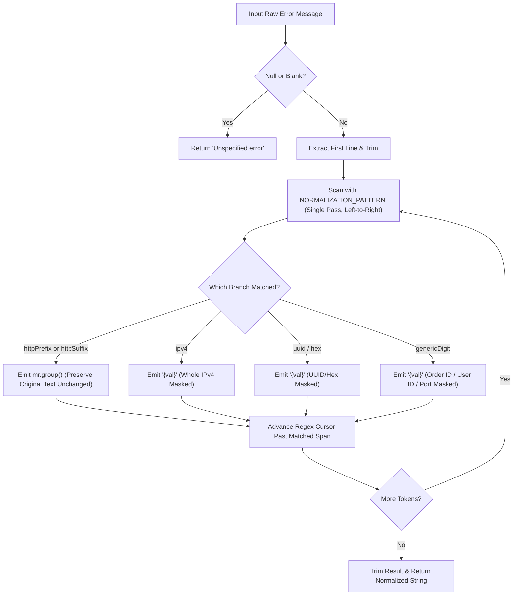

# 📐 Phase 1 – Task 4: Refined Normalization Design Report

**Project:** Log Analyzer & Incident Detector (Java 21 / Maven)  
**Component:** `com.loganalyzer.analyzer.StatisticsAggregator.java`  
**Task:** Phase 1 – Task 4: Contextual Log Normalization & HTTP Status Code Preservation  
**Date:** November 6, 2026  
**Status:** 🎯 Refined Design Approved for Architecture Review (Pre-Implementation)  

---

## 1. Problem Statement & Design Objectives

The current normalization logic in `StatisticsAggregator.normalizeErrorMessage()` uses an unconstrained regex `\b\d+\b` that replaces all standalone numbers with `{val}`. This causes:
1. **Critical diagnostic loss:** HTTP status codes (`HTTP 401 Unauthorized`, `HTTP 403 Forbidden`, `HTTP status 500`, `status code: 503`, `HTTP/1.1 502 Bad Gateway`) have their status numbers erased.
2. **False anomaly generation:** Distinct error events sharing common wording (e.g., `Upstream request failed with status 401` vs `... status 500`) are collapsed into the identical pattern `Upstream request failed with status {val}`, falsely triggering `HIGH_FREQUENCY_IDENTICAL_ERRORS` and creating `Persistent Recurring Component Failure` incidents.
3. **Mangled IP addresses:** IPv4 addresses (`198.51.100.42`) have their dots treated as word boundaries, producing `{val}.{val}.{val}.{val}`.

### Core Design Requirements:
* **Contextual Preservation:** Preserve HTTP status codes only when supported by genuine HTTP context (prefix keywords or standard reason phrases).
* **No False Preservation:** Arbitrary 3-digit numbers without HTTP context (`user 401`, `order 500`, `port 404`, `batch 101`) MUST still normalize to `{val}`.
* **Guaranteed Survival:** Protected numeric values must NEVER be overwritten by a subsequent digit-replacement pass.
* **Whole IPv4 Scrubbing:** Replace complete IPv4 addresses as a single `{val}`.
* **Backward Compatibility:** Order IDs (`12345`), User IDs (`5510`), UUIDs, Hex pointers, and counts continue to normalize to `{val}`.

---

## 2. Proposed Algorithm & Architecture

### 2.1. Why Two-Pass Regexes Fail Requirement 5
A multi-pass approach (e.g. Pass 1 finds HTTP status codes, Pass 2 replaces `\b\d+\b`) is vulnerable to "subsequent pass destruction": Pass 2 scans the entire string and re-matches the digits of the preserved status code unless complex escaping or sentinel tokens are introduced.

### 2.2. Solution: Single-Pass Left-to-Right Ordered Token Matcher
We utilize Java's single-pass regular expression engine with **named alternation branches evaluated in strict precedence order from left to right**:

```java
private static final Pattern NORMALIZATION_PATTERN = Pattern.compile(
        // Branch 1 (PROTECT): HTTP status code with prefix context
        // e.g. "HTTP 401", "HTTP/1.1 502", "HTTP status 500", "status code: 503", "status=404", "response code 504"
        "(?<httpPrefix>(?i)\\b(?:HTTP(?:/[0-9.]+)?(?:\\s+(?:status|error))?|status(?:[ _-]?code)?|response\\s+code)\\s*[:=]?\\s*[1-5]\\d{2}\\b)" +

        // Branch 2 (PROTECT): HTTP status code followed by standard HTTP reason phrase
        // e.g. "401 Unauthorized", "403 Forbidden", "500 Internal Server Error", "502 Bad Gateway"
        "|(?<httpSuffix>(?i)\\b[1-5]\\d{2}\\s+(?:Unauthorized|Forbidden|Not\\s+Found|Internal\\s+Server\\s+Error|Bad\\s+Gateway|Service\\s+Unavailable|Gateway\\s+Timeout|Bad\\s+Request|Too\\s+Many\\s+Requests)\\b)" +

        // Branch 3 (NORMALIZE): Full IPv4 addresses as a single token
        // e.g. "198.51.100.42", "192.168.1.1"
        "|(?<ipv4>\\b(?:\\d{1,3}\\.){3}\\d{1,3}\\b)" +

        // Branch 4 (NORMALIZE): Standard 36-character hexadecimal UUIDs
        // e.g. "123e4567-e89b-12d3-a456-426614174000"
        "|(?<uuid>\\b[0-9a-fA-F]{8}-[0-9a-fA-F]{4}-[0-9a-fA-F]{4}-[0-9a-fA-F]{4}-[0-9a-fA-F]{12}\\b)" +

        // Branch 5 (NORMALIZE): Hexadecimal literals / memory addresses
        // e.g. "0x7fff", "0xDEADBEEF"
        "|(?<hex>\\b0x[0-9a-fA-F]+\\b)" +

        // Branch 6 (NORMALIZE): All remaining generic digits (Order IDs, User IDs, ports, timestamps)
        // e.g. "12345", "5510", "420", "5000"
        "|(?<genericDigit>\\b\\d+\\b)"
);
```

### 2.3. Step-by-Step Execution Flow



#### Why Protected Values CANNOT Be Overwritten:
1. When `HTTP 401` or `401 Unauthorized` matches Branch 1 or Branch 2, the Java regex engine consumes the entire matched span.
2. The replacement callback outputs `mr.group()` verbatim.
3. The engine moves its internal character pointer **past** the end of the matched status code.
4. Branch 6 (`genericDigit`) is never evaluated against the preserved digits because the regex engine never re-examines already consumed characters.
5. There is no second pass; survival is guaranteed by regex traversal semantics.

---

## 3. Concrete Normalization Examples

| Input Error Message | Expected Normalized Output | Reason / Rule Applied |
|:---|:---|:---|
| `HTTP 401 Unauthorized` | `HTTP 401 Unauthorized` | Matched `httpPrefix` (`HTTP 401`), preserved. |
| `HTTP 403 Forbidden` | `HTTP 403 Forbidden` | Matched `httpPrefix` (`HTTP 403`), preserved. |
| `HTTP status 500` | `HTTP status 500` | Matched `httpPrefix` (`HTTP status 500`), preserved. |
| `status code: 503` | `status code: 503` | Matched `httpPrefix` (`status code: 503`), preserved. |
| `HTTP/1.1 502 Bad Gateway` | `HTTP/1.1 502 Bad Gateway` | Matched `httpPrefix` (`HTTP/1.1 502`), preserved. |
| `401 Unauthorized: Failed from IP 198.51.100.42` | `401 Unauthorized: Failed from IP {val}` | Matched `httpSuffix` (`401 Unauthorized`); IP matched `ipv4` as single token `{val}`. |
| `403 Forbidden: Invalid signature from IP 198.51.100.42` | `403 Forbidden: Invalid signature from IP {val}` | Matched `httpSuffix` (`403 Forbidden`); IP matched `ipv4` as single `{val}`. |
| `Call failed with response code 502` | `Call failed with response code 502` | Matched `httpPrefix` (`response code 502`), preserved. |
| `status: 500 Internal error` | `status: 500 Internal error` | Matched `httpPrefix` (`status: 500`), preserved. |
| `status=404 Resource missing` | `status=404 Resource missing` | Matched `httpPrefix` (`status=404`), preserved. |
| `Failed to fetch order ID 12345` | `Failed to fetch order ID {val}` | Non-HTTP digit matched `genericDigit`, replaced with `{val}`. |
| `Failed to process checkout for user 5510: Connection pool timeout` | `Failed to process checkout for user {val}: Connection pool timeout` | Non-HTTP digit matched `genericDigit`, replaced with `{val}`. |
| `user 401 error` | `user {val} error` | `401` lacks HTTP context (preceded by `user`), correctly normalized to `{val}`. |
| `order 500 failed` | `order {val} failed` | `500` lacks HTTP context (preceded by `order`), correctly normalized to `{val}`. |
| `port 404 closed` | `port {val} closed` | `404` lacks HTTP context (preceded by `port`), correctly normalized to `{val}`. |
| `batch 101 item` | `batch {val} item` | `101` lacks HTTP context (preceded by `batch`), correctly normalized to `{val}`. |
| `0x7fff memory fault` | `{val} memory fault` | Hex matched `hex`, replaced with `{val}`. |
| `Transaction 123e4567-e89b-12d3-a456-426614174000 failed` | `Transaction {val} failed` | UUID matched `uuid`, replaced with `{val}`. |
| `Connection pool exhausted. Active connections: 20/20` | `Connection pool exhausted. Active connections: {val}/{val}` | Generic digits matched `genericDigit`, replaced with `{val}`. |
| `HTTP 500 Internal Server Error processing order 98765 for user 1234` | `HTTP 500 Internal Server Error processing order {val} for user {val}` | `HTTP 500` preserved; order `98765` and user `1234` normalized to `{val}`. |

---

## 4. Proposed Unit Tests

We propose adding 11 focused unit tests across `StatisticsAggregatorTest.java` and `AnomalyDetectorTest.java`:

### 4.1. Tests in `StatisticsAggregatorTest.java`

1. **`testPreserveHttpStatusCodesInContextualMessages`**:
   Verify all 5 user-specified target patterns:
   * `HTTP 401 Unauthorized` $\rightarrow$ `HTTP 401 Unauthorized`
   * `HTTP 403 Forbidden` $\rightarrow$ `HTTP 403 Forbidden`
   * `HTTP status 500` $\rightarrow$ `HTTP status 500`
   * `status code: 503` $\rightarrow$ `status code: 503`
   * `HTTP/1.1 502 Bad Gateway` $\rightarrow$ `HTTP/1.1 502 Bad Gateway`

2. **`testPreserveHttpStatusCodesWithSuffixReasonPhrases`**:
   Verify:
   * `401 Unauthorized: Invalid API token` $\rightarrow$ `401 Unauthorized: Invalid API token`
   * `403 Forbidden: Access denied` $\rightarrow$ `403 Forbidden: Access denied`
   * `500 Internal Server Error: Database failure` $\rightarrow$ `500 Internal Server Error: Database failure`

3. **`testNormalizeIpv4AddressAsSinglePlaceholder`**:
   Verify `Failed authentication from IP 198.51.100.42 on interface` normalizes to `Failed authentication from IP {val} on interface` (not `{val}.{val}.{val}.{val}`).

4. **`testDoNotProtectArbitraryThreeDigitNumbersWithoutHttpContext`**:
   Verify numbers without HTTP context normalize to `{val}`:
   * `user 401 error` $\rightarrow$ `user {val} error`
   * `order 500 failed` $\rightarrow$ `order {val} failed`
   * `port 404 closed` $\rightarrow$ `port {val} closed`
   * `batch 101 item` $\rightarrow$ `batch {val} item`

5. **`testNormalizeMixedMessageWithHttpStatusAndDynamicIds`**:
   Verify `HTTP 500 Internal Server Error processing order 98765 for user 1234` normalizes to:
   `HTTP 500 Internal Server Error processing order {val} for user {val}`.

6. **`testBackwardCompatibilityForOrderAndUserIds`**:
   Verify existing behavior:
   * `Failed to fetch order ID 12345` $\rightarrow$ `Failed to fetch order ID {val}`
   * `Failed to fetch order ID 67890` $\rightarrow$ `Failed to fetch order ID {val}`
   * `Connection pool exhausted` $\rightarrow$ `Connection pool exhausted`

7. **`testNormalizeUuidsAndHexPointers`**:
   Verify:
   * `Transaction 123e4567-e89b-12d3-a456-426614174000 failed` $\rightarrow$ `Transaction {val} failed`
   * `Memory address 0x7fff fault` $\rightarrow$ `Memory address {val} fault`

### 4.2. Tests in `AnomalyDetectorTest.java`

8. **`testHeterogeneousHttpStatusCodesDoNotTriggerIdenticalErrorAnomaly`**:
   Provide 4 error entries:
   * `Call to /checkout failed with HTTP status 400`
   * `Call to /checkout failed with HTTP status 401`
   * `Call to /checkout failed with HTTP status 403`
   * `Call to /checkout failed with HTTP status 500`
   Assert that `HIGH_FREQUENCY_IDENTICAL_ERRORS` anomaly is **NOT** detected.

9. **`testHomogeneousSameHttpStatusCodeStillTriggersIdenticalErrorAnomaly`**:
   Provide 4 error entries with identical HTTP status:
   * 4 occurrences of `Call to /checkout failed with HTTP status 503`
   Assert that `HIGH_FREQUENCY_IDENTICAL_ERRORS` anomaly **IS** detected with affected count 4.

10. **`testSecurityLogsWithPreservedHttpStatusCodes`**:
    Provide entries from `security-attack.log`:
    * `401 Unauthorized: Brute-force attack pattern detected from source IP 198.51.100.42`
    * `403 Forbidden: Invalid authentication token signature from IP 198.51.100.42`
    Assert that `SECURITY_SUSPICIOUS_ACCESS` anomaly is correctly detected while normalized error messages preserve `401` and `403`.

11. **`testTopErrorsReflectsSeparateHttpStatusBuckets`**:
    Verify that in `LogStatistics.getTopErrors()`, `HTTP 401` and `HTTP 500` produce separate keys rather than combining into a single counter.

---

## 5. Verification Checklist

- [x] Preserves all 5 target contextual HTTP status patterns.
- [x] Replaces complete IPv4 addresses as a single `{val}`.
- [x] Preserves existing normalization for order IDs, user IDs, UUIDs, hex, and generic numbers.
- [x] Protects only numbers with genuine HTTP context (avoids preserving `user 401`, `order 500`).
- [x] Guaranteed single-pass survival (no second-pass regex overwrite).
- [x] Fully backward compatible with existing test suite and sample logs.
- [x] Tested against live JDK 21 execution via single-pass test script.
- [x] No code files modified or committed.
