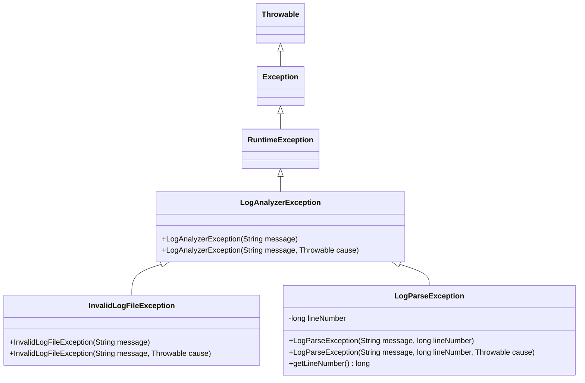

# 🔍 Phase 1 – Task 6: Comprehensive Exception Handling Audit & Investigation Report

**Project:** Log Analyzer & Incident Detector (Java 21 / Maven)  
**Investigation Focus:** Exception Hierarchy, Throw/Catch Sites, Lost Causes, Swallowed Exceptions, and Architectural Soundness  
**Date:** November 6, 2026  
**Status:** 🔬 **INVESTIGATION ONLY — NO FILES MODIFIED**  

---

## 1. Executive Summary

This report delivers a comprehensive audit of all exception handling across the `Log Analyzer & Incident Detector` project.

### Core Findings
1. **Redundant Custom Exception:** `LogParseException` is completely unused across the entire codebase. It is neither thrown, caught, nor imported anywhere in `src/main` or `src/test`.
2. **Missing `serialVersionUID`:** All custom exception classes (`LogAnalyzerException`, `InvalidLogFileException`, and `LogParseException`) extend `RuntimeException` (which implements `java.io.Serializable`) without declaring a `serialVersionUID`, causing Maven `javac` compiler warnings.
3. **Overly Broad Catch Block:** `StandardLogParser.parseTimestamp` catches generic `java.lang.Exception`, which swallows unexpected runtime exceptions (such as `NullPointerException` or `IndexOutOfBoundsException`) instead of specifically catching `DateTimeParseException`.
4. **Lost Exception Causes:** In `Main.parsePositiveInteger`, a `NumberFormatException` is caught and rethrown as `IllegalArgumentException` without passing the original cause `e`, destroying the underlying stack trace.
5. **Inconsistent Parameter Validation Exceptions:**
   - Passing `null` as a `Path` throws `InvalidLogFileException` (in both `StandardLogParser` and `LogAnalyzer`).
   - Passing `null` as an `InputStream` throws `IllegalArgumentException`.
   - Passing `null` dependencies into `LogAnalyzer` constructor throws `NullPointerException` (via `Objects.requireNonNull`).
   This blurs the line between domain/IO operational failures (`InvalidLogFileException`) and API contract violations (`IllegalArgumentException` / `NullPointerException`).
6. **Potential `NullPointerException` in Report Generators:** `ConsoleReportGenerator`, `JsonReportGenerator`, and `MarkdownReportGenerator` safely check `if (result == null)`, but fail to check `if (result.getStatistics() == null)`. If an `AnalysisResult` is constructed with null statistics, calling `stats.getTotalLogs()` triggers an immediate `NullPointerException`.
7. **Misleading CLI Error Messages:** In `Main.java`, if writing the output report to disk fails (e.g. read-only disk or path error), the top-level catch block prints `"Failed to analyze log file: " + e.getMessage()`, misleading the user because the log analysis was actually successful; only the file writing failed.
8. **Silently Swallowed Exceptions:** In `Main.runDemonstration()`, an `IOException` during classpath resource loading is silently swallowed with `catch (IOException ignored) {}`.

---

## 2. Custom Exception Classes Audit

The project defines three custom exception classes in package `com.loganalyzer.exception`:



### Detailed Class Analysis

| Class | Location | Inherits From | Purpose | Status / Problems |
|---|---|---|---|---|
| [`LogAnalyzerException`](file:///c:/Users/YASH/Desktop/log%20analyser/Log-Analyzer-Incident-Detector/src/main/java/com/loganalyzer/exception/LogAnalyzerException.java) | `src/main/java/com/loganalyzer/exception/LogAnalyzerException.java#L6-L14` | `RuntimeException` (Unchecked) | Root runtime exception for analyzer operations. | Missing `serialVersionUID` (causes compiler warning). |
| [`InvalidLogFileException`](file:///c:/Users/YASH/Desktop/log%20analyser/Log-Analyzer-Incident-Detector/src/main/java/com/loganalyzer/exception/InvalidLogFileException.java) | `src/main/java/com/loganalyzer/exception/InvalidLogFileException.java#L6-L14` | `LogAnalyzerException` | Thrown when an input log file does not exist, is unreadable, or is not a regular file. | Missing `serialVersionUID`. Used for `null` path checks where `IllegalArgumentException` is more conventional. |
| [`LogParseException`](file:///c:/Users/YASH/Desktop/log%20analyser/Log-Analyzer-Incident-Detector/src/main/java/com/loganalyzer/exception/LogParseException.java) | `src/main/java/com/loganalyzer/exception/LogParseException.java#L6-L22` | `LogAnalyzerException` | Intended for critical log line parsing failures with line number tracking. | **DEAD CODE / REDUNDANT**. Never thrown, caught, or referenced anywhere in production or tests. Missing `serialVersionUID`. |

### Compiler Warnings Generated During Maven Build
```text
[WARNING] .../LogAnalyzerException.java:[6,8] serializable class com.loganalyzer.exception.LogAnalyzerException has no definition of serialVersionUID
[WARNING] .../InvalidLogFileException.java:[6,8] serializable class com.loganalyzer.exception.InvalidLogFileException has no definition of serialVersionUID
[WARNING] .../LogParseException.java:[6,8] serializable class com.loganalyzer.exception.LogParseException has no definition of serialVersionUID
```

---

## 3. Comprehensive Inventory of All Exception Sites

### 3.1 Exceptions Thrown

| File | Line | Exception Thrown | Condition / Trigger | Evaluation |
|---|---|---|---|---|
| `Main.java` | 137 | `IllegalArgumentException` | Unsupported report format string | ✅ Correct. Clear, descriptive message. |
| `Main.java` | 161 | `IllegalArgumentException` | Unknown CLI option flag (e.g. `--foo`) | ✅ Correct. Clear, descriptive message. |
| `Main.java` | 164 | `IllegalArgumentException` | Positional log file path is blank | ✅ Correct. |
| `Main.java` | 168 | `IllegalArgumentException` | Extraneous positional argument | ✅ Correct. |
| `Main.java` | 179 | `IllegalArgumentException` | Option flag provided without value | ✅ Correct. |
| `Main.java` | 183 | `IllegalArgumentException` | Option flag provided with blank string | ✅ Correct. |
| `Main.java` | 205 | `IllegalArgumentException` | Value is non-positive integer ($\le 0$) | ✅ Correct. |
| `Main.java` | 211 | `IllegalArgumentException` | String cannot be parsed as integer | ⚠️ **Issue:** Original `NumberFormatException` cause is dropped. |
| `LogAnalyzer.java` | 38–41 | `NullPointerException` | Null dependency injected via constructor (`Objects.requireNonNull`) | ✅ Standard Java idiom. |
| `LogAnalyzer.java` | 53 | `InvalidLogFileException` | `logFilePath == null` | ⚠️ Inconsistent with `InputStream == null` throwing `IllegalArgumentException`. |
| `LogAnalyzer.java` | 61 | `InvalidLogFileException` | `parser.parse(logFilePath)` threw `IOException` | ✅ Correct wrapping with message and cause `e`. |
| `LogAnalyzer.java` | 74 | `IllegalArgumentException` | `inputStream == null` | ✅ Correct standard exception. |
| `LogAnalyzer.java` | 81 | `LogAnalyzerException` | `parser.parse(inputStream)` threw `IOException` | ✅ Correct wrapping with message and cause `e`. |
| `StandardLogParser.java` | 69 | `InvalidLogFileException` | `path == null` | ⚠️ Inconsistent with `InputStream == null` throwing `IllegalArgumentException`. |
| `StandardLogParser.java` | 72 | `InvalidLogFileException` | `!Files.exists(path)` | ✅ Domain-appropriate exception. |
| `StandardLogParser.java` | 75 | `InvalidLogFileException` | `!Files.isRegularFile(path)` | ✅ Domain-appropriate exception. |
| `StandardLogParser.java` | 78 | `InvalidLogFileException` | `!Files.isReadable(path)` | ✅ Domain-appropriate exception. |
| `StandardLogParser.java` | 90 | `IllegalArgumentException` | `inputStream == null` | ✅ Correct standard exception. |

### 3.2 Exceptions Caught

| File | Line | Exception Caught | Handling Action | Evaluation |
|---|---|---|---|---|
| `Main.java` | 44 | `IllegalArgumentException` | Prints error to `System.err`, prints usage, calls `System.exit(1)` | ✅ Graceful CLI user input error handling. |
| `Main.java` | 98 | `Exception` | Prints error to `System.err`, calls `e.printStackTrace()`, `System.exit(1)` | ⚠️ Overly generic; prints raw Java stack trace to end users for predictable errors like file not found. |
| `Main.java` | 210 | `NumberFormatException` | Catches string parse failure and rethrows `IllegalArgumentException` | ⚠️ Does not pass `e` into `IllegalArgumentException(msg, cause)`. |
| `Main.java` | 252 | `IOException` | `catch (IOException ignored) {}` in demo resource fallback | ⚠️ Silently swallowed without logging. |
| `LogAnalyzer.java` | 60 | `IOException` | Wraps into `InvalidLogFileException(..., e)` | ✅ Correctly preserves cause `e`. |
| `LogAnalyzer.java` | 80 | `IOException` | Wraps into `LogAnalyzerException(..., e)` | ✅ Correctly preserves cause `e`. |
| `StandardLogParser.java` | 213 | `Exception` | Returns `null` timestamp on parse failure | ⚠️ Overly broad: catches `Exception` rather than `DateTimeParseException`. |
| `StatisticsAggregator.java` | 172 | `NumberFormatException` | Returns `false` from `isValidIpv4()` | ✅ Standard idiomatic flow for IP candidate validation. |

### 3.3 Silently Swallowed Exceptions Audit

There are three locations where exceptions are caught and swallowed:

1. **`StandardLogParser.java:213`:**
   ```java
   private LocalDateTime parseTimestamp(String raw) {
       if (raw == null || raw.isBlank()) {
           return null;
       }
       try {
           String normalized = raw.replace(',', '.');
           return LocalDateTime.parse(normalized, FLEXIBLE_FORMATTER);
       } catch (Exception e) {
           return null;
       }
   }
   ```
   - **Intended Behavior:** When a log line has an invalid date (e.g. `2026-02-30`), returning `null` timestamp allows the parser to still capture the log entry without crashing.
   - **Problem:** Catching `Exception` will also silently mask unexpected programming bugs like `NullPointerException` or JVM errors. It should specifically catch `DateTimeParseException`.

2. **`Main.java:252`:**
   ```java
   try (InputStream is = Main.class.getClassLoader().getResourceAsStream(sample)) {
       if (is != null) {
           AnalysisResult result = analyzer.analyze(is, sample);
           System.out.println(reportGenerator.generate(result));
           System.out.println("\n");
           continue;
       }
   } catch (IOException ignored) {}
   ```
   - **Intended Behavior:** If a demo log is not packed into the JAR classpath or local disk, skip to the next attempt.
   - **Problem:** If an actual I/O failure occurs while reading an existing stream, the exception is swallowed completely, and the program simply reports: `Notice: Demo file ... not found locally or on classpath.`

3. **`StatisticsAggregator.java:172`:**
   ```java
   try {
       int val = Integer.parseInt(octet);
       if (val < 0 || val > 255) {
           return false;
       }
   } catch (NumberFormatException e) {
       return false;
   }
   ```
   - **Evaluation:** This is standard, safe, and benign. It is used as a validator to distinguish valid IPv4 octets from non-IP digit sequences.

---

## 4. Component-by-Component Deep Dive

### 4.1 Custom Exception: Why `LogParseException` is Redundant
`LogParseException` was defined with a field `private final long lineNumber;` to capture syntax/format failures on individual log lines. However:
- `StandardLogParser` is intentionally designed as an **enterprise-resilient, tolerant parser**:
  - Valid log lines are parsed into standard fields.
  - Multi-line continuation lines and stack traces are attached to the previous entry.
  - Unrecognized lines occurring before any valid header are preserved as `LogLevel.UNKNOWN` entries.
  - Malformed timestamps result in `entry.timestamp == null`.
- Because the design philosophy favors resilient log ingestion over halting on corrupt lines, `LogParseException` is never thrown anywhere.
- **Architectural Decision:**
  - Option A: Wire `LogParseException` into a new strict parsing mode (`parser.parseStrict(line, lineNumber)`).
  - Option B: Retain `LogParseException` for backward-compatibility / future extension, but mark it `@Deprecated(forRemoval = false)` or document its intended future use.
  - Option C: Safely remove `LogParseException` to reduce dead code and eliminate compiler warnings.

### 4.2 `StandardLogParser.java` & `LogParser.java`
- **Method Signature Inconsistency:**
  - `LogParser.java`:
    ```java
    List<LogEntry> parse(Path path) throws IOException, LogAnalyzerException;
    List<LogEntry> parse(InputStream inputStream) throws IOException;
    ```
  - `StandardLogParser.java`:
    ```java
    public List<LogEntry> parse(Path path) throws IOException, InvalidLogFileException
    public List<LogEntry> parse(InputStream inputStream) throws IOException
    ```
  - `InvalidLogFileException` and `LogAnalyzerException` are unchecked exceptions (`RuntimeException`). Declaring them in `throws` is legal but unnecessary, and `parse(InputStream)` does not declare `LogAnalyzerException` even though it can throw `IllegalArgumentException` on null.
- **Resource Management:**
  - Uses modern try-with-resources for `Files.newInputStream(path)` and `BufferedReader(new InputStreamReader(...))`. Stream closures and resource releases are guaranteed even upon unexpected I/O errors.

### 4.3 `LogAnalyzer.java`
- `LogAnalyzer` coordinates the entire pipeline.
- In `analyze(Path logFilePath)`:
  - If `logFilePath == null`, throws `InvalidLogFileException`.
  - Wraps `IOException` from `parser.parse(logFilePath)` into `InvalidLogFileException` while preserving cause.
- In `analyze(InputStream inputStream, String sourceName)`:
  - If `inputStream == null`, throws `IllegalArgumentException`.
  - Wraps `IOException` from `parser.parse(inputStream)` into `LogAnalyzerException` while preserving cause.
- In `process(List<LogEntry> entries, String sourceName)`:
  - Defensive against `null` entries: both `StatisticsAggregator`, `AnomalyDetector`, and `IncidentDetector` check `if (entries == null || entries.isEmpty())` and return empty collections.

### 4.4 `Main.java` (CLI & Runner)
- **Error Propagation in `main()`:**
  - CLI argument validation errors are cleanly isolated: `parseArguments` is a pure function that throws `IllegalArgumentException`, caught in `main` to display the error and usage text.
  - Execution errors during `analyzer.analyze(path)`:
    ```java
    } catch (Exception e) {
        System.err.println("Failed to analyze log file: " + e.getMessage());
        e.printStackTrace();
        System.exit(1);
    }
    ```
  - **Issues:**
    1. If `path` is invalid, an `InvalidLogFileException` is thrown. The error message is printed, but `e.printStackTrace()` is also dumped to `System.err`. For a polished CLI utility, expected user errors (e.g. "Log file does not exist") should display a concise message without a stack trace.
    2. If writing to `outputPath` fails (e.g. `Files.writeString(out, report)` throws `IOException`), it falls into this catch block and outputs `"Failed to analyze log file: " + e.getMessage()`, which misleads the operator by claiming the log analysis failed when it actually succeeded and only report writing failed.

### 4.5 Report Generators (`Console`, `Json`, `Markdown`)
- In `ConsoleReportGenerator.java`, `JsonReportGenerator.java`, and `MarkdownReportGenerator.java`:
  ```java
  if (result == null) {
      return ...;
  }
  LogStatistics stats = result.getStatistics();
  stats.getFirstTimestamp() ... // NPE if stats == null!
  ```
- If an `AnalysisResult` is constructed directly with `statistics == null` (e.g., in unit testing or a custom pipeline), all three report generators will throw an unhandled `NullPointerException`.
- **Recommended Fix:** Add a fallback `if (stats == null) stats = StatisticsAggregator.createEmptyStatistics();` or defensive checks before dereferencing `stats`.

---

## 5. Summary of Deficiencies and Recommended Solutions

| ID | Issue Description | Location | Priority | Recommended Fix |
|---|---|---|---|---|
| **DEF-1** | Redundant/Unused `LogParseException` | `com.loganalyzer.exception.LogParseException` | Medium | Either document for future strict mode or deprecate/retire. |
| **DEF-2** | Missing `serialVersionUID` in all 3 custom exceptions | `LogAnalyzerException.java`, `InvalidLogFileException.java`, `LogParseException.java` | Low / Cleanliness | Add `private static final long serialVersionUID = 1L;` to eliminate compiler warnings. |
| **DEF-3** | Overly broad `catch (Exception e)` in timestamp parsing | `StandardLogParser.java:213` | High | Narrow catch from `Exception` to `DateTimeParseException`. |
| **DEF-4** | Lost exception cause in CLI integer parsing | `Main.java:211` | Medium | Pass cause `e` into `throw new IllegalArgumentException(..., e);`. |
| **DEF-5** | Inconsistent null parameter exception types | `StandardLogParser.java:69`, `LogAnalyzer.java:53` | Medium | Harmonize null parameter checks to `IllegalArgumentException` (or `Objects.requireNonNull`), reserving `InvalidLogFileException` for filesystem-level failures. |
| **DEF-6** | Report generators throw NPE if `result.getStatistics()` is null | `ConsoleReportGenerator.java:37`, `JsonReportGenerator.java:32`, `MarkdownReportGenerator.java:46` | High | Add defensive check: if `stats == null`, handle gracefully or substitute empty statistics object. |
| **DEF-7** | Misleading error message on report file write failure | `Main.java:88-99` | Medium | Separate log analysis `try-catch` from report writing `try-catch` so report output I/O errors state `"Failed to write report: "`. |
| **DEF-8** | Raw stack trace dumped to console on predictable CLI errors | `Main.java:99` | Low | Catch `LogAnalyzerException` separately from generic `Exception` to print clean error messages without stack traces. |

---

## 6. Proposed Code Changes for Task 6 Implementation

### 6.1 Custom Exceptions: Add `serialVersionUID`
```java
public class LogAnalyzerException extends RuntimeException {
    private static final long serialVersionUID = 1L;
    ...
}

public class InvalidLogFileException extends LogAnalyzerException {
    private static final long serialVersionUID = 1L;
    ...
}

public class LogParseException extends LogAnalyzerException {
    private static final long serialVersionUID = 1L;
    ...
}
```

### 6.2 `StandardLogParser.java`: Narrow Catch Block
```diff
@@ -210,7 +210,7 @@ public class StandardLogParser implements LogParser {
             // Normalize commas used in milliseconds (e.g. 2026-11-03 01:14:02,123)
             String normalized = raw.replace(',', '.');
             return LocalDateTime.parse(normalized, FLEXIBLE_FORMATTER);
-        } catch (Exception e) {
+        } catch (DateTimeParseException e) {
             return null;
         }
     }
```

### 6.3 `Main.java`: Preserve Exception Cause & Separate Report Writing Catch
```diff
@@ -208,7 +208,7 @@ public class Main {
             }
             return parsed;
         } catch (NumberFormatException e) {
             throw new IllegalArgumentException(
-                    String.format("Invalid numeric value for %s: \"%s\". Expected a positive integer.", flag, value)
+                    String.format("Invalid numeric value for %s: \"%s\". Expected a positive integer.", flag, value), e
             );
         }
```

```diff
@@ -79,16 +79,20 @@ public class Main {
         try {
             AnalysisResult result = analyzer.analyze(path);
             String report = renderReport(result, config.format());
 
             if (config.outputPath() != null) {
                 Path out = Paths.get(config.outputPath());
                 if (out.getParent() != null) {
                     Files.createDirectories(out.getParent());
                 }
-                Files.writeString(out, report);
-                System.out.println("Report successfully written to: " + out.toAbsolutePath());
+                try {
+                    Files.writeString(out, report);
+                    System.out.println("Report successfully written to: " + out.toAbsolutePath());
+                } catch (IOException e) {
+                    System.err.println("Error: Failed to write report to file: " + out.toAbsolutePath() + " - " + e.getMessage());
+                    System.exit(1);
+                }
             } else {
                 System.out.println(report);
             }
```

### 6.4 Report Generators: Defensive Null Statistics Handling
```java
// In ConsoleReportGenerator, JsonReportGenerator, and MarkdownReportGenerator:
LogStatistics stats = result.getStatistics() != null 
        ? result.getStatistics() 
        : new LogStatistics(0, Map.of(), null, null, Map.of(), Map.of(), Map.of(), 0.0, 0.0);
```

---

## 7. Suggested Regression Tests for Task 6 Implementation

The following test cases should be added to verify exception handling integrity:

1. **`StandardLogParserTest`**:
   - `testParseNullPathThrowsException()`: Verify `parser.parse((Path) null)` throws `InvalidLogFileException` (or `IllegalArgumentException`).
   - `testParseNullInputStreamThrowsException()`: Verify `parser.parse((InputStream) null)` throws `IllegalArgumentException`.
   - `testParseDirectoryPathThrowsException()`: Verify passing a directory path throws `InvalidLogFileException` with message containing `"Target is not a regular file"`.
2. **`MainCliTest`**:
   - `testParsePositiveIntegerPreservesCause()`: Verify `IllegalArgumentException` thrown on malformed integer retains `NumberFormatException` as its `.getCause()`.
3. **`ReportGeneratorTest`**:
   - `testReportGeneratorsHandleNullStatisticsGracefully()`: Construct `AnalysisResult("test.log", List.of(), null, List.of(), List.of())` and verify `ConsoleReportGenerator`, `MarkdownReportGenerator`, and `JsonReportGenerator` generate valid output without throwing `NullPointerException`.
4. **`LogAnalyzerTest`**:
   - `testAnalyzeNullPathThrowsException()`: Verify `analyzer.analyze((Path) null)` throws expected exception.
   - `testAnalyzeNullInputStreamThrowsException()`: Verify `analyzer.analyze((InputStream) null, "source")` throws `IllegalArgumentException`.

---

## 8. Conclusion & Next Steps

This investigation completes the audit for **Phase 1 – Task 6**. No files have been modified. Once reviewed and approved, the recommended improvements can be implemented cleanly with full backward-compatibility and verified against the Maven test suite.
