# Phase 2 — Comprehensive Java OOP Architecture Audit Report

**Project:** `Log-Analyzer-Incident-Detector` (Java 21, Maven)  
**Academic Context:** 2nd-Year B.Tech Computer Science & Engineering (Object-Oriented Programming Course Project — 20 Marks)  
**Target Audience:** Beginner Student Developer preparing for viva voce defense and code review  
**Audit Date:** 2026-11-07  
**Scope:** Investigation and architectural evaluation of `src/main/java` and `src/test/java`  

---

## 1. Executive Summary

This audit performs an in-depth evaluation of the Object-Oriented Programming (OOP) design of the **Log Analyzer & Incident Detector** project. The project currently comprises **23 production Java classes, records, interfaces, and enums** across 5 packages, backed by **94 automated unit and integration tests**.

The existing codebase already exhibits strong engineering hygiene:
- Immutability and defensive copying are widely practiced in domain models.
- Core operations are decoupled through interfaces (`LogParser`, `ReportGenerator`).
- Exception handling is robust and structured via a domain-specific hierarchy.
- Loose coupling and dependency injection are established in the primary coordinator (`LogAnalyzer`).

However, from an **academic B.Tech grading perspective**, certain classic OOP concepts expected by evaluators are either under-represented or absent:
1. **Zero Abstract Classes:** All abstraction is done through interfaces; there are no `abstract class` declarations in the project.
2. **Class Inheritance is Limited to Exceptions:** The `extends` keyword is only used for custom exceptions (`InvalidLogFileException extends LogAnalyzerException`). There is no class inheritance in domain models or service layers.
3. **Generics are Only Consumed:** The project uses `java.util.List<T>` and `java.util.Map<K,V>`, but does not declare any custom generic classes or generic methods (`<T>`).

This report provides the student with an exact blueprint of where each concept exists, genuine architectural trade-offs, a prioritized Phase 2 roadmap, and practical viva questions with model answers.

---

## 2. Concept-by-Concept OOP Evaluation

### 2.1 Encapsulation
*Definition: Bundling data and methods that operate on that data within a class while restricting direct access to internal state.*

* **Where Used in Code:**
  - [`LogEntry.java`](file:///c:/Users/YASH/Desktop/log%20analyser/Log-Analyzer-Incident-Detector/src/main/java/com/loganalyzer/model/LogEntry.java#L13-L20): All 8 fields (`lineNumber`, `timestamp`, `level`, `thread`, `logger`, `message`, `stackTrace`, `rawLine`) are declared `private final`.
  - [`Anomaly.java`](file:///c:/Users/YASH/Desktop/log%20analyser/Log-Analyzer-Incident-Detector/src/main/java/com/loganalyzer/model/Anomaly.java#L13-L20): All fields `private final`.
  - [`Incident.java`](file:///c:/Users/YASH/Desktop/log%20analyser/Log-Analyzer-Incident-Detector/src/main/java/com/loganalyzer/model/Incident.java#L13-L21): All fields `private final`.
  - [`LogStatistics.java`](file:///c:/Users/YASH/Desktop/log%20analyser/Log-Analyzer-Incident-Detector/src/main/java/com/loganalyzer/model/LogStatistics.java#L11-L19): All fields `private final`.
  - [`AnalysisResult.java`](file:///c:/Users/YASH/Desktop/log%20analyser/Log-Analyzer-Incident-Detector/src/main/java/com/loganalyzer/model/AnalysisResult.java#L10-L14): All fields `private final`.
  - [`CliConfig` in Main.java](file:///c:/Users/YASH/Desktop/log%20analyser/Log-Analyzer-Incident-Detector/src/main/java/com/loganalyzer/Main.java#L32-L40): Java 21 `record` with immutable components.
  - Enums ([`LogLevel.java`](file:///c:/Users/YASH/Desktop/log%20analyser/Log-Analyzer-Incident-Detector/src/main/java/com/loganalyzer/model/LogLevel.java#L17), [`IncidentSeverity.java`](file:///c:/Users/YASH/Desktop/log%20analyser/Log-Analyzer-Incident-Detector/src/main/java/com/loganalyzer/model/IncidentSeverity.java#L12)): `private final` fields with getter methods.

* **Implementation Details:**
  1. **Defensive Copying in Constructors:**
     - `LogEntry` constructor lines 36: `this.stackTrace = stackTrace != null ? new ArrayList<>(stackTrace) : new ArrayList<>();`
     - `LogStatistics` constructor lines 31-36: `this.countsByLevel = countsByLevel != null ? Map.copyOf(countsByLevel) : Collections.emptyMap();`
  2. **Defensive Returns in Accessors:**
     - `LogEntry.getStackTrace()` (line 65): Returns `Collections.unmodifiableList(stackTrace)`.
     - `Incident.getRecommendations()` (line 76): Returns `Collections.unmodifiableList(recommendations)`.
  3. **State Validation:**
     - `Anomaly` (line 37): Clamps severity score: `this.severityScore = Math.max(0.0, Math.min(1.0, severityScore));`.
     - `Objects.requireNonNull(...)` and `Objects.requireNonNullElse(...)` guard against invalid null arguments across constructors.

* **Classification:** **Properly Implemented**

* **Design Weaknesses & Observations:**
  - `LogEntry.addStackTraceLine(String line)` (line 68): Modifies the internal `stackTrace` list after object creation. While practical for multiline parsing in `StandardLogParser`, this means `LogEntry` is **not 100% immutable**. In a viva, if asked "Is LogEntry immutable?", the student must explain that while references are `final`, `addStackTraceLine` mutates the underlying `ArrayList`.

---

### 2.2 Inheritance
*Definition: A mechanism where a new class derives properties and behaviors from an existing class (`is-a` relationship).*

* **Where Used in Code:**
  - [`LogAnalyzerException.java:6`](file:///c:/Users/YASH/Desktop/log%20analyser/Log-Analyzer-Incident-Detector/src/main/java/com/loganalyzer/exception/LogAnalyzerException.java#L6): `extends RuntimeException`
  - [`InvalidLogFileException.java:6`](file:///c:/Users/YASH/Desktop/log%20analyser/Log-Analyzer-Incident-Detector/src/main/java/com/loganalyzer/exception/InvalidLogFileException.java#L6): `extends LogAnalyzerException`
  - [`LogParseException.java:6`](file:///c:/Users/YASH/Desktop/log%20analyser/Log-Analyzer-Incident-Detector/src/main/java/com/loganalyzer/exception/LogParseException.java#L6): `extends LogAnalyzerException`
  - Implicit inheritance: All classes extend `java.lang.Object`; all enums extend `java.lang.Enum<E>`.

* **Where Inheritance is Missing:**
  - **Report Generators:** [`ConsoleReportGenerator`](file:///c:/Users/YASH/Desktop/log%20analyser/Log-Analyzer-Incident-Detector/src/main/java/com/loganalyzer/report/ConsoleReportGenerator.java), [`JsonReportGenerator`](file:///c:/Users/YASH/Desktop/log%20analyser/Log-Analyzer-Incident-Detector/src/main/java/com/loganalyzer/report/JsonReportGenerator.java), and [`MarkdownReportGenerator`](file:///c:/Users/YASH/Desktop/log%20analyser/Log-Analyzer-Incident-Detector/src/main/java/com/loganalyzer/report/MarkdownReportGenerator.java) all implement `ReportGenerator` independently. They duplicate common logic:
    1. Null-statistics fallback: `result.getStatistics() != null ? result.getStatistics() : new LogStatistics(0, ...)` is copied verbatim across all three generators (Console line 29, JSON line 26, Markdown line 27).
    2. Date formatting helper methods.
    3. Status computation (`CRITICAL`, `WARNING`, `HEALTHY`).
  - **No Abstract Base Class:** There is no `AbstractReportGenerator` to hold shared state, shared formatting constants, or template methods.

* **Classification:** **Partially Implemented**
  - Properly implemented in the exception hierarchy.
  - Absent in domain, service, and reporting layers. Evaluators in an OOP exam typically look for class inheritance beyond exceptions.

* **Recommended Academic Improvement:**
  - Introduce `AbstractReportGenerator implements ReportGenerator` that extracts shared null-safety checks, status badge computation, and date formatting helpers. Subclasses then extend this abstract base class.

---

### 2.3 Abstraction (Abstract Classes and Interfaces)
*Definition: Hiding complex implementation details and exposing only essential contract features to the caller.*

* **Where Used in Code:**
  - [`LogParser.java`](file:///c:/Users/YASH/Desktop/log%20analyser/Log-Analyzer-Incident-Detector/src/main/java/com/loganalyzer/parser/LogParser.java#L14):
    ```java
    public interface LogParser {
        List<LogEntry> parse(Path path) throws IOException, LogAnalyzerException;
        List<LogEntry> parse(InputStream inputStream) throws IOException;
        LogEntry parseLine(String line, long lineNumber);
    }
    ```
  - [`ReportGenerator.java`](file:///c:/Users/YASH/Desktop/log%20analyser/Log-Analyzer-Incident-Detector/src/main/java/com/loganalyzer/report/ReportGenerator.java#L8):
    ```java
    public interface ReportGenerator {
        String generate(AnalysisResult result);
    }
    ```

* **Where Abstraction is Missing:**
  - **Zero Abstract Classes:** There is not a single `abstract class` in the entire project.
  - In [`LogAnalyzer.java:25-28`](file:///c:/Users/YASH/Desktop/log%20analyser/Log-Analyzer-Incident-Detector/src/main/java/com/loganalyzer/analyzer/LogAnalyzer.java#L25-L28):
    - `parser` is programmed to the interface `LogParser` (strong abstraction).
    - But `statisticsAggregator`, `anomalyDetector`, and `incidentDetector` are referenced as concrete classes (`StatisticsAggregator`, `AnomalyDetector`, `IncidentDetector`).

* **Classification:** **Partially Implemented**
  - Interfaces are well-designed and adhere to Interface Segregation.
  - Abstract classes are missing entirely.

* **Recommended Academic Improvement:**
  - Introduce `AbstractReportGenerator` as an abstract base class.
  - Demonstrate the classic academic distinction: *Interface defines what to do (contract), while Abstract Class provides how to do common parts (code reuse and template skeleton).*

---

### 2.4 Polymorphism (Overriding and Overloading)
*Definition: The ability of a single interface or method to take multiple forms at compile-time (overloading) or runtime (overriding).*

* **1. Runtime Polymorphism (Method Overriding / Dynamic Method Dispatch):**
  - `ReportGenerator` interface is implemented by 3 distinct classes, each overriding `generate(AnalysisResult)`:
    - `ConsoleReportGenerator.generate(AnalysisResult)`: ASCII table and console colors.
    - `MarkdownReportGenerator.generate(AnalysisResult)`: GitHub-flavored markdown with callouts.
    - `JsonReportGenerator.generate(AnalysisResult)`: Machine-readable JSON string.
  - In [`Main.java:257-264`](file:///c:/Users/YASH/Desktop/log%20analyser/Log-Analyzer-Incident-Detector/src/main/java/com/loganalyzer/Main.java#L257-L264):
    ```java
    ReportGenerator generator = switch (format) {
        case "markdown", "md" -> new MarkdownReportGenerator();
        case "json" -> new JsonReportGenerator();
        default -> new ConsoleReportGenerator();
    };
    return generator.generate(result); // Polymorphic dispatch at runtime
    ```
  - `StandardLogParser` overrides `parse(Path)`, `parse(InputStream)`, and `parseLine(String, long)` from `LogParser`.
  - Object method overrides:
    - `LogEntry` overrides `equals(Object)`, `hashCode()`, and `toString()`.
    - `Anomaly` and `Incident` override `toString()`.

* **2. Compile-Time Polymorphism (Method Overloading / Static Polymorphism):**
  - `LogAnalyzer`:
    - `analyze(Path logFilePath)` (line 52)
    - `analyze(InputStream inputStream, String sourceName)` (line 73)
  - `AnomalyDetector`:
    - `detectPatternAnomalies(...)` with 8 parameters (line 275)
    - `detectPatternAnomalies(...)` with 9 parameters including `LogLevel minimumLevel` (line 286)
  - `LogParser`:
    - `parse(Path)` vs `parse(InputStream)`
  - Exception Constructors:
    - `LogAnalyzerException(String)` vs `LogAnalyzerException(String, Throwable)`
    - `InvalidLogFileException(String)` vs `InvalidLogFileException(String, Throwable)`
    - `LogParseException(String, long)` vs `LogParseException(String, long, Throwable)`

* **Classification:** **Properly Implemented**

* **Viva Value:** High. The student can directly point to `Main.renderReport` as dynamic polymorphism and `LogAnalyzer.analyze` as static polymorphism.

---

### 2.5 Constructors and Constructor Overloading
*Definition: Special methods invoked during object creation to initialize state, with constructor overloading providing alternative initialization paths.*

* **Where Used in Code:**
  - **Constructor Chaining using `this(...)`:**
    - [`LogAnalyzer.java:30-42`](file:///c:/Users/YASH/Desktop/log%20analyser/Log-Analyzer-Incident-Detector/src/main/java/com/loganalyzer/analyzer/LogAnalyzer.java#L30-L42):
      ```java
      public LogAnalyzer() {
          this(new StandardLogParser(), new StatisticsAggregator(), new AnomalyDetector(), new IncidentDetector());
      }
      public LogAnalyzer(LogParser parser, StatisticsAggregator statisticsAggregator,
                         AnomalyDetector anomalyDetector, IncidentDetector incidentDetector) { ... }
      ```
      *Academic significance: Demonstrates Dependency Injection (DI) and constructor chaining to avoid code duplication.*
    - [`AnomalyDetector.java:48-64`](file:///c:/Users/YASH/Desktop/log%20analyser/Log-Analyzer-Incident-Detector/src/main/java/com/loganalyzer/analyzer/AnomalyDetector.java#L48-L64):
      ```java
      public AnomalyDetector() {
          this(5, 60, 4, 3, 2, 3);
      }
      public AnomalyDetector(int errorBurstThreshold, int windowSeconds, ...) { ... }
      ```
  - **Superclass Constructor Invocation using `super(...)`:**
    - `InvalidLogFileException.java`: Invokes `super(message)` and `super(message, cause)`.
    - `LogParseException.java`: Invokes `super(String.format(...))` and `super(String.format(...), cause)`.
  - **Builder Pattern with Private Constructor Simulation:**
    - [`LogEntry.Builder`](file:///c:/Users/YASH/Desktop/log%20analyser/Log-Analyzer-Incident-Detector/src/main/java/com/loganalyzer/model/LogEntry.java#L124-L179): Provides fluent initialization to prevent constructor telescoping.

* **Classification:** **Properly Implemented**

---

### 2.6 Composition and Aggregation
*Definition: Modeling `has-a` relationships. Composition is strong ownership (part cannot exist without the whole); Aggregation is weak ownership (part exists independently).*

* **1. Composition (Strong "Has-A"):**
  - `AnalysisResult` composes `LogStatistics`, `List<Anomaly>`, `List<Incident>`, and `List<LogEntry>`. The lifetime of the analysis bundle is managed as a coherent unit.
  - `LogAnalyzer` composes its operational pipeline (`parser`, `statisticsAggregator`, `anomalyDetector`, `incidentDetector`).

* **2. Aggregation (Weak "Has-A"):**
  - `Incident` aggregates `List<Anomaly>` and `List<LogEntry>` (sample root-cause entries). The anomalies and log entries exist independently of any individual incident.
  - `Anomaly` aggregates `List<LogEntry>` (sample entries illustrating the pattern).

* **Design Weakness:**
  - In [`AnomalyDetector.java:243`](file:///c:/Users/YASH/Desktop/log%20analyser/Log-Analyzer-Incident-Detector/src/main/java/com/loganalyzer/analyzer/AnomalyDetector.java#L243):
    ```java
    StatisticsAggregator aggregator = new StatisticsAggregator();
    ```
    Inside `detectIdenticalErrors()`, `AnomalyDetector` directly instantiates `new StatisticsAggregator()`. This is unnecessary hidden instantiation rather than aggregating or reusing the instance provided by `LogAnalyzer`.

* **Classification:** **Properly Implemented** (with the minor coupling note above).

---

### 2.7 Java Generics
*Definition: Parameterizing types to provide compile-time type safety and eliminate runtime casting.*

* **Where Used in Code:**
  - Standard collections parameterization:
    - `List<LogEntry>`, `List<Anomaly>`, `List<Incident>`, `List<String>`
    - `Map<LogLevel, Long>`, `Map<String, Long>`, `Map<String, List<LogEntry>>`
    - `EnumMap<LogLevel, Long>`, `LinkedHashMap<String, Long>`
  - Generic Stream operations in `StatisticsAggregator.java:101-109`:
    ```java
    Map.Entry.<String, Long>comparingByValue().reversed()
    ```
  - Comparator generics in `AnomalyDetector.java:147`:
    ```java
    Comparator.comparing(LogEntry::getTimestamp).thenComparingLong(LogEntry::getLineNumber)
    ```

* **Where Generics are Missing:**
  - **Zero Custom Generic Types:** The project defines no generic classes (`class Foo<T>`), generic interfaces (`interface Bar<T>`), or custom generic methods (`public <T> T doSomething()`).
  - Evaluators frequently ask: *"Show me where you wrote a generic class or generic method in your code."* Currently, the student can only answer that they *used* Java's built-in generics in collections and streams.

* **Classification:** **Partially Implemented** (Consumed extensively, but never authored).

* **Recommended Academic Improvement:**
  - Introduce a generic filtering or rule evaluation interface, e.g.:
    `public interface Rule<T> { boolean evaluate(T item); }` or parameterize reports/parsers where logically applicable without adding bloat.

---

### 2.8 Exception Handling and Custom Exception Hierarchy
*Definition: Handling abnormal conditions gracefully using a structured hierarchy and ensuring resource safety.*

* **Where Used in Code:**
  - **Three-Tier Exception Hierarchy:**
    ```text
    java.lang.Throwable
    └── java.lang.Exception
        └── java.lang.RuntimeException (Unchecked)
            └── LogAnalyzerException (serialVersionUID = 1L)
                ├── InvalidLogFileException (serialVersionUID = 1L)
                └── LogParseException (serialVersionUID = 1L)
    ```
  - **Exception Chaining (Preserving Root Cause):**
    - `LogAnalyzer.java:62`: `new InvalidLogFileException("Failed to read log file: ...", e)` preserves `IOException`.
    - `LogAnalyzer.java:82`: `new LogAnalyzerException("Failed to parse log stream: ...", e)` preserves `IOException`.
    - `Main.java:242`: `new IllegalArgumentException("Invalid numeric value...", e)` preserves `NumberFormatException`.
  - **Try-With-Resources (Automatic Resource Management — ARM):**
    - `StandardLogParser.java:82`: `try (InputStream is = Files.newInputStream(path))`
    - `StandardLogParser.java:96`: `try (BufferedReader reader = new BufferedReader(...))`
    - `Main.java:298`: `try (InputStream is = Main.class.getClassLoader().getResourceAsStream(sample))`
  - **Specific vs General Catching:**
    - `StandardLogParser.java:213`: Catches `DateTimeParseException`, returning `null`.
    - `Main.java:84-97`: Catches `InvalidLogFileException`, then `LogAnalyzerException`, then `Exception` fallback.
    - `Main.java:114-123`: Catches `IOException` separately from general `Exception`.

* **Classification:** **Properly Implemented**

---

### 2.9 SOLID Principles Assessment

| Principle | Adherence | Implementation Evidence | Academic Explanation |
| :--- | :---: | :--- | :--- |
| **S — Single Responsibility (SRP)** | **High** | `StandardLogParser` only parses; `AnomalyDetector` only spots patterns; `IncidentDetector` only groups & prioritizes; `ReportGenerator` only formats. | Each class has exactly one reason to change. |
| **O — Open/Closed (OCP)** | **High** | `ReportGenerator` interface allows adding `HtmlReportGenerator` without modifying existing generators. `LogParser` allows adding `JsonLogParser` without altering `LogAnalyzer`. | Open for extension, closed for modification. |
| **L — Liskov Substitution (LSP)** | **High** | Any `ReportGenerator` (Console, Markdown, JSON) can replace another in `Main.renderReport` without crashing or altering program correctness. | Subtypes can substitute their base types seamlessly. |
| **I — Interface Segregation (ISP)** | **High** | `ReportGenerator` has 1 method (`generate`). `LogParser` has 3 cohesive parsing methods. | No fat interfaces forcing clients to implement dummy methods. |
| **D — Dependency Inversion (DIP)** | **Medium** | `LogAnalyzer` depends on the `LogParser` interface. However, it still depends directly on concrete classes `StatisticsAggregator`, `AnomalyDetector`, and `IncidentDetector`. | Partially implemented. Swapping detectors requires modifying `LogAnalyzer`. |

---

## 3. Section A: Current Class Hierarchy

### Mermaid Diagram

```mermaid
classDiagram
    direction TB

    %% Interfaces
    class LogParser {
        <<interface>>
        +parse(Path) List~LogEntry~
        +parse(InputStream) List~LogEntry~
        +parseLine(String, long) LogEntry
    }

    class ReportGenerator {
        <<interface>>
        +generate(AnalysisResult) String
    }

    %% Parser Implementation
    class StandardLogParser {
        +parse(Path) List~LogEntry~
        +parse(InputStream) List~LogEntry~
        +parseLine(String, long) LogEntry
    }
    LogParser <|.. StandardLogParser : implements

    %% Report Implementations
    class ConsoleReportGenerator {
        +generate(AnalysisResult) String
    }
    class MarkdownReportGenerator {
        +generate(AnalysisResult) String
    }
    class JsonReportGenerator {
        +generate(AnalysisResult) String
    }
    ReportGenerator <|.. ConsoleReportGenerator : implements
    ReportGenerator <|.. MarkdownReportGenerator : implements
    ReportGenerator <|.. JsonReportGenerator : implements

    %% Exception Hierarchy
    class RuntimeException {
        <<external>>
    }
    class LogAnalyzerException {
        +serialVersionUID: long
    }
    class InvalidLogFileException {
        +serialVersionUID: long
    }
    class LogParseException {
        +serialVersionUID: long
        -lineNumber: long
        +getLineNumber() long
    }
    RuntimeException <|-- LogAnalyzerException : extends
    LogAnalyzerException <|-- InvalidLogFileException : extends
    LogAnalyzerException <|-- LogParseException : extends

    %% Domain Models
    class LogEntry {
        -lineNumber: long
        -timestamp: LocalDateTime
        -level: LogLevel
        -thread: String
        -logger: String
        -message: String
        -stackTrace: List~String~
        -rawLine: String
        +builder() Builder
    }

    class Anomaly {
        -id: String
        -type: AnomalyType
        -description: String
        -startTime: LocalDateTime
        -endTime: LocalDateTime
        -affectedLogCount: int
        -sampleEntries: List~LogEntry~
        -severityScore: double
    }

    class Incident {
        -id: String
        -title: String
        -severity: IncidentSeverity
        -category: IncidentCategory
        -summary: String
        -detectedAt: LocalDateTime
        -triggeredAnomalies: List~Anomaly~
        -rootCauseEntries: List~LogEntry~
        -recommendations: List~String~
    }

    class LogStatistics {
        -totalLogs: long
        -countsByLevel: Map
        -errorPercentage: double
        -warningPercentage: double
    }

    class AnalysisResult {
        -sourceName: String
        -entries: List~LogEntry~
        -statistics: LogStatistics
        -anomalies: List~Anomaly~
        -incidents: List~Incident~
    }

    %% Service Coordinators
    class LogAnalyzer {
        -parser: LogParser
        -statisticsAggregator: StatisticsAggregator
        -anomalyDetector: AnomalyDetector
        -incidentDetector: IncidentDetector
        +analyze(Path) AnalysisResult
        +analyze(InputStream, String) AnalysisResult
        +process(List~LogEntry~, String) AnalysisResult
    }
```


### Text-Based Hierarchy
```text
java.lang.Object
├── com.loganalyzer.Main
├── com.loganalyzer.Main$CliConfig (Record)
├── com.loganalyzer.analyzer.AnomalyDetector
├── com.loganalyzer.analyzer.IncidentDetector
├── com.loganalyzer.analyzer.LogAnalyzer
├── com.loganalyzer.analyzer.StatisticsAggregator
├── com.loganalyzer.model.AnalysisResult
├── com.loganalyzer.model.Anomaly
├── com.loganalyzer.model.Incident
├── com.loganalyzer.model.LogEntry
├── com.loganalyzer.model.LogEntry$Builder
├── com.loganalyzer.model.LogStatistics
├── com.loganalyzer.parser.StandardLogParser (implements LogParser)
├── com.loganalyzer.report.ConsoleReportGenerator (implements ReportGenerator)
├── com.loganalyzer.report.JsonReportGenerator (implements ReportGenerator)
├── com.loganalyzer.report.MarkdownReportGenerator (implements ReportGenerator)
├── java.lang.Enum<E>
│   ├── com.loganalyzer.model.AnomalyType
│   ├── com.loganalyzer.model.IncidentCategory
│   ├── com.loganalyzer.model.IncidentSeverity
│   └── com.loganalyzer.model.LogLevel
└── java.lang.Throwable
    └── java.lang.Exception
        └── java.lang.RuntimeException
            └── com.loganalyzer.exception.LogAnalyzerException
                ├── com.loganalyzer.exception.InvalidLogFileException
                └── com.loganalyzer.exception.LogParseException
```

---

## 4. Section B: Important Class Relationships

| Source Class | Target Class / Interface | Relationship Type | UML Notation | Code Location & Description |
| :--- | :--- | :--- | :---: | :--- |
| `StandardLogParser` | `LogParser` | **Realization** | `..\|>` | `StandardLogParser.java:28` (`implements LogParser`) |
| `ConsoleReportGenerator` | `ReportGenerator` | **Realization** | `..\|>` | `ConsoleReportGenerator.java:16` (`implements ReportGenerator`) |
| `JsonReportGenerator` | `ReportGenerator` | **Realization** | `..\|>` | `JsonReportGenerator.java:15` (`implements ReportGenerator`) |
| `MarkdownReportGenerator` | `ReportGenerator` | **Realization** | `..\|>` | `MarkdownReportGenerator.java:16` (`implements ReportGenerator`) |
| `InvalidLogFileException` | `LogAnalyzerException` | **Generalization** | `--\|>` | `InvalidLogFileException.java:6` (`extends LogAnalyzerException`) |
| `LogParseException` | `LogAnalyzerException` | **Generalization** | `--\|>` | `LogParseException.java:6` (`extends LogAnalyzerException`) |
| `LogAnalyzer` | `LogParser` | **Composition** | `*--` | `LogAnalyzer.java:25` (`private final LogParser parser`) |
| `LogAnalyzer` | `StatisticsAggregator` | **Composition** | `*--` | `LogAnalyzer.java:26` (`private final StatisticsAggregator ...`) |
| `LogAnalyzer` | `AnomalyDetector` | **Composition** | `*--` | `LogAnalyzer.java:27` (`private final AnomalyDetector ...`) |
| `LogAnalyzer` | `IncidentDetector` | **Composition** | `*--` | `LogAnalyzer.java:28` (`private final IncidentDetector ...`) |
| `AnalysisResult` | `LogStatistics` | **Composition** | `*--` | `AnalysisResult.java:12` (`private final LogStatistics statistics`) |
| `AnalysisResult` | `Anomaly` | **Aggregation** | `o--` | `AnalysisResult.java:13` (`private final List<Anomaly> anomalies`) |
| `AnalysisResult` | `Incident` | **Aggregation** | `o--` | `AnalysisResult.java:14` (`private final List<Incident> incidents`) |
| `Incident` | `Anomaly` | **Aggregation** | `o--` | `Incident.java:19` (`private final List<Anomaly> triggeredAnomalies`) |
| `Incident` | `LogEntry` | **Aggregation** | `o--` | `Incident.java:20` (`private final List<LogEntry> rootCauseEntries`) |
| `Anomaly` | `LogEntry` | **Aggregation** | `o--` | `Anomaly.java:19` (`private final List<LogEntry> sampleEntries`) |
| `Main` | `LogAnalyzer` | **Dependency** | `..>` | `Main.java:79` (instantiates and calls `analyzer.analyze(path)`) |
| `Main` | `ReportGenerator` | **Dependency** | `..>` | `Main.java:258` (instantiates concrete generator polymorphically) |
| `AnomalyDetector` | `StatisticsAggregator` | **Dependency** | `..>` | `AnomalyDetector.java:243` (`new StatisticsAggregator()`) |

---

## 5. Section C: OOP Concept Coverage Table

| Concept | Status | Key Classes / Methods | Academic Viva Value | Recommendations |
| :--- | :---: | :--- | :---: | :--- |
| **Encapsulation** | **Properly Implemented** | `LogEntry`, `Anomaly`, `Incident`, `LogStatistics`, `CliConfig` | ⭐⭐⭐⭐⭐ (Very High) | Point out `private final` fields, defensive copying in constructors, and unmodifiable list getters. |
| **Inheritance** | **Partially Implemented** | `LogAnalyzerException` -> `InvalidLogFileException`, `LogParseException` | ⭐⭐⭐ (Moderate) | Implement `AbstractReportGenerator` to demonstrate class inheritance in business logic. |
| **Abstraction** | **Partially Implemented** | Interfaces: `LogParser`, `ReportGenerator`. *(Abstract classes: None)* | ⭐⭐⭐⭐ (High) | Introduce an `abstract class` to demonstrate the difference between an `interface` and an `abstract class`. |
| **Polymorphism** | **Properly Implemented** | Dynamic: `ReportGenerator.generate()`, `LogParser.parse()`. Static: `LogAnalyzer.analyze()`, `AnomalyDetector.detectPatternAnomalies()`. | ⭐⭐⭐⭐⭐ (Very High) | Highlight dynamic dispatch in `Main.renderReport` and method overloading in `LogAnalyzer`. |
| **Constructors** | **Properly Implemented** | Chaining `this(...)` in `LogAnalyzer`, `AnomalyDetector`. `LogEntry.Builder`. | ⭐⭐⭐⭐ (High) | Explain how constructor chaining provides sensible defaults while allowing full dependency injection. |
| **Composition vs Aggregation** | **Properly Implemented** | Composition in `LogAnalyzer`, `AnalysisResult`. Aggregation in `Incident` -> `Anomaly` -> `LogEntry`. | ⭐⭐⭐⭐⭐ (Very High) | Use `AnalysisResult` vs `Incident` to explain the lifecycle difference during viva. |
| **Generics** | **Partially Implemented** | Consumed via `List<T>`, `Map<K,V>`, `Comparator`, Streams. *(Custom generic classes: None)* | ⭐⭐ (Low/Moderate) | Introduce a lightweight generic interface or utility to show evaluators that generics can be written, not just consumed. |
| **Exception Handling** | **Properly Implemented** | `LogAnalyzerException` hierarchy, try-with-resources, exception chaining with cause. | ⭐⭐⭐⭐⭐ (Very High) | Explain checked vs unchecked exceptions, cause chaining, and automatic resource closing (`AutoCloseable`). |
| **SOLID Principles** | **Properly Implemented** | SRP across all packages, OCP in report generators, LSP in exceptions & generators, ISP in `LogParser`. | ⭐⭐⭐⭐⭐ (Very High) | Explain SRP with parser vs aggregator vs detector; explain OCP with adding new report formats. |

---

## 6. Section D: Prioritized Phase 2 Implementation Roadmap

To maximize the student's marks (20/20) while avoiding unnecessary complexity or breaking changes, here is a clean, prioritized roadmap:

### Priority 1: Introduce `AbstractReportGenerator` (Inheritance & Abstraction)
- **Problem:** Currently, all three report generators (`ConsoleReportGenerator`, `MarkdownReportGenerator`, `JsonReportGenerator`) duplicate null-statistics checks, date formatters, and status determination logic.
- **Solution:** Create `public abstract class AbstractReportGenerator implements ReportGenerator`.
  - Put shared logic (e.g. `protected LogStatistics resolveStatistics(AnalysisResult result)`, `protected String determineOverallStatus(AnalysisResult result)`) into the abstract base class.
  - Subclasses call `super` or inherited helper methods.
- **Academic Value:** Demonstrates class inheritance (`extends`), abstract classes (`abstract class`), code reuse, and Template Method design pattern.

### Priority 2: Author a Lightweight Generic Interface (Java Generics)
- **Problem:** Evaluators often look for `<T>` authored in the code, rather than merely imported from `java.util`.
- **Solution:** Introduce a generic interface for anomaly detection or data filtering, for example:
  `public interface Filter<T> { boolean matches(T item); }`
  or a generic analyzer interface.
- **Academic Value:** Gives the student concrete evidence of custom Java Generics to present to the examiner.

### Priority 3: Eliminate Tight Coupling in `AnomalyDetector`
- **Problem:** `AnomalyDetector:243` directly instantiates `new StatisticsAggregator()`.
- **Solution:** Pass `StatisticsAggregator` into `AnomalyDetector`'s constructor or inject message normalization as a dependency.
- **Academic Value:** Solidifies Dependency Inversion (DIP) and true composition.

---

## 7. Section E: Viva Defense Guide (Questions & Model Answers)

Here are 12 high-probability viva questions tailored to this codebase, with clear, second-year B.Tech CSE model answers:

#### Q1: "What is Encapsulation, and where have you implemented it in your project?"
> **Answer:** "Encapsulation is restricting direct access to an object's internal components while exposing a controlled public interface. In my project, look at `LogEntry.java` (lines 13–20) and `LogStatistics.java` (lines 11–19). All instance fields are declared `private final`. Furthermore, I used **defensive copying**: when a caller passes a `List` or `Map`, the constructor creates a new copy (`new ArrayList<>(list)` or `Map.copyOf(map)`), and the getters return an unmodifiable view using `Collections.unmodifiableList()`. This prevents external code from altering the internal state of our model objects."

#### Q2: "What is the difference between Method Overloading and Method Overriding in your code?"
> **Answer:** "Method Overloading is **compile-time (static) polymorphism**, where methods in the same class share a name but differ in parameter count or types. An example is in `LogAnalyzer.java`, where `analyze(Path)` is overloaded with `analyze(InputStream, String)`.
> Method Overriding is **runtime (dynamic) polymorphism**, where a subclass or implementing class provides a specific implementation of a method declared in an interface or superclass. For example, `ConsoleReportGenerator`, `MarkdownReportGenerator`, and `JsonReportGenerator` all override `generate(AnalysisResult)` from the `ReportGenerator` interface. When `Main.java` executes `generator.generate(result)`, the JVM decides at runtime which generator to invoke via dynamic method dispatch."

#### Q3: "What is the difference between Composition and Aggregation? Show where both appear in your project."
> **Answer:** "Both are `has-a` relationships. **Composition** represents strong ownership: the part's lifecycle is bound to the whole. For example, `AnalysisResult` composes `LogStatistics`; the statistics object has no meaningful standalone lifecycle outside that analysis run.
> **Aggregation** represents weak ownership: the part can exist independently. For example, `Incident` aggregates `Anomaly` objects and `LogEntry` objects. Those log entries and anomalies were discovered independently and continue to exist even if the incident object is discarded."

#### Q4: "Why did you choose Unchecked Exceptions (`RuntimeException`) instead of Checked Exceptions?"
> **Answer:** "In modern Java engineering, unchecked exceptions (`RuntimeException`) reduce method signature clutter and avoid unnecessary `try-catch` boilerplate across intermediate layers. In my project, `LogAnalyzerException` extends `RuntimeException`. However, I explicitly document critical failure modes using Javadoc `@throws`, validate inputs defensively at the boundaries (e.g. throwing `IllegalArgumentException` on null paths), and wrap lower-level checked `IOException`s into meaningful domain exceptions like `InvalidLogFileException` while preserving the root cause using exception chaining."

#### Q5: "What is Exception Chaining and why is it important?"
> **Answer:** "Exception chaining is wrapping a lower-level exception inside a higher-level domain exception while preserving the original cause. In `LogAnalyzer.java` (line 62), when an `IOException` occurs while reading a file, we throw `new InvalidLogFileException(\"...\", e)`. Passing `e` as the second argument sets the root cause. This ensures that when debugging, the stack trace shows both the high-level business error and the underlying low-level cause (like `FileNotFoundException` or `AccessDeniedException`)."

#### Q6: "Why did you use `try-with-resources` in `StandardLogParser`?"
> **Answer:** "In `StandardLogParser.java` (lines 82 and 96), file streams and buffered readers implement `java.lang.AutoCloseable`. The `try-with-resources` construct guarantees that the `InputStream` and `BufferedReader` are automatically closed when the block finishes, whether it terminates normally or abruptly due to an exception. This completely prevents file handle leaks and resource starvation."

#### Q7: "What is the Builder Pattern, and why did you use it in `LogEntry`?"
> **Answer:** "The Builder Pattern is a creational design pattern that separates the construction of a complex object from its representation. `LogEntry` has 8 fields. If we relied only on standard constructors, we would suffer from the **telescoping constructor anti-pattern**, which is error-prone because multiple parameters are of the same type (`String`). In `LogEntry.java` (lines 124–179), the static `Builder` class allows us to construct entries fluently: `LogEntry.builder().lineNumber(1).level(LogLevel.INFO).message(\"...\").build()`, which is readable, self-documenting, and safe."

#### Q8: "How does your project adhere to the Open/Closed Principle (OCP)?"
> **Answer:** "The Open/Closed Principle states that software entities should be open for extension, but closed for modification. In my report package, if we need to support an HTML report or CSV report in the future, we simply create a new class `HtmlReportGenerator implements ReportGenerator`. We do not need to modify `ConsoleReportGenerator`, `MarkdownReportGenerator`, or `JsonReportGenerator`. In `Main.java`, we only add the new format string to the switch selector. The existing generators remain completely untouched and tested."

#### Q9: "Why does `Main.CliConfig` use a Java `record` instead of a regular class?"
> **Answer:** "A `record` (introduced in Java 14 and finalized in Java 16) is a concise syntax for creating immutable data carriers. In `Main.java` (lines 32–40), `CliConfig` automatically provides private final fields, a canonical constructor, accessors (`filePath()`, `format()`), `equals()`, `hashCode()`, and `toString()`. It eliminates boilerplate and guarantees that CLI arguments cannot be modified once parsed."

#### Q10: "What is constructor chaining using `this(...)` and why is it useful?"
> **Answer:** "Constructor chaining is when one constructor in a class calls another constructor in the same class using `this(args)`. In `LogAnalyzer.java` (lines 30–32), the default no-arg constructor `LogAnalyzer()` calls the 4-argument constructor `this(new StandardLogParser(), new StatisticsAggregator(), ...)` with default implementations. This provides a zero-configuration default for end users while simultaneously allowing test classes to inject mock or custom components via the overloaded constructor."

#### Q11: "Why do your custom exceptions have `serialVersionUID = 1L`?"
> **Answer:** "`serialVersionUID` is a unique identifier used during Java Object Serialization to verify that the sender and receiver of a serialized object have loaded classes that are compatible. Because `Throwable` implements `java.io.Serializable`, all custom exceptions inherit serializability. Adding an explicit `private static final long serialVersionUID = 1L;` prevents JVM compiler warnings and ensures deterministic deserialization across different JVM versions or platforms."

#### Q12: "If you had to improve the OOP architecture of this project in Phase 2, what would you do first?"
> **Answer:** "I would introduce an `AbstractReportGenerator` base class. Right now, `ConsoleReportGenerator`, `MarkdownReportGenerator`, and `JsonReportGenerator` all implement the `ReportGenerator` interface, but they duplicate identical null-safety fallbacks and status calculation logic. Extracting this common code into an abstract base class demonstrates the Template Method pattern and class inheritance (`extends`), fulfilling the complete academic spectrum of OOP concepts."

---

## 8. Conclusion

The existing Java architecture is robust, clean, and production-ready for an incident detector. Its foundations in encapsulation, interface abstraction, polymorphism, and exception safety are sound. By introducing an `AbstractReportGenerator` base class in Phase 2, the student will have concrete, defensible examples of **all four fundamental OOP pillars (Encapsulation, Inheritance, Abstraction, Polymorphism)** ready to present during the academic viva.
