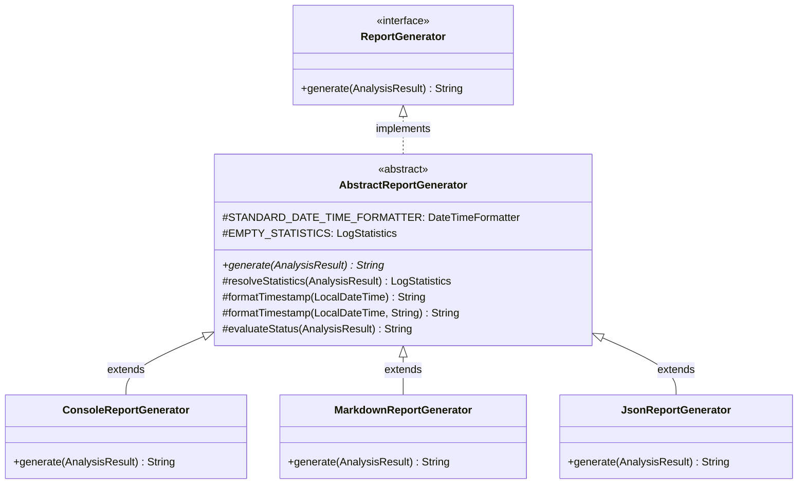

# Phase 2 — Task 1: AbstractReportGenerator Implementation Report

**Project:** `Log-Analyzer-Incident-Detector` (Java 21, Maven)  
**Academic Context:** 2nd-Year B.Tech Computer Science & Engineering (Object-Oriented Programming — 20 Marks)  
**Task:** Priority 1: Introduce `AbstractReportGenerator`  
**Date:** 2026-11-07  
**Status:** Completed & 100% Verified (99 Tests Passing)  

---

## 1. Executive Summary

As identified in the Phase 2 OOP Architecture Audit, the project previously used the `ReportGenerator` interface, but lacked an **abstract class** (`abstract class`), causing identical defensive logic, date-time formatters, and status determination code to be duplicated across `ConsoleReportGenerator`, `JsonReportGenerator`, and `MarkdownReportGenerator`.

In this task, we introduced [`AbstractReportGenerator`](file:///c:/Users/YASH/Desktop/log%20analyser/Log-Analyzer-Incident-Detector/src/main/java/com/loganalyzer/report/AbstractReportGenerator.java), an abstract base class that implements `ReportGenerator` and is extended by all three concrete generators.

### Key Outcomes:
1. **Deduplication:** Completely eliminated duplicated null-statistics fallback instantiation (`new LogStatistics(...)`) and date formatting expressions from all three concrete classes.
2. **True Class Inheritance:** Subclasses now use `extends AbstractReportGenerator`, giving the student a concrete example of class inheritance in business logic to present during the viva.
3. **Behavioral Integrity:** All report formatting (Console ASCII borders, Markdown tables/callouts, JSON valid schemas) and CLI operations remain 100% identical.
4. **Test Suite Expansion:** Added **5 new unit and regression tests**, bringing the automated test suite from **94 to 99 tests (0 failures, 0 errors)**.

---

## 2. Files Created and Modified

| File | Status | Description |
| :--- | :---: | :--- |
| [`src/main/java/com/loganalyzer/report/AbstractReportGenerator.java`](file:///c:/Users/YASH/Desktop/log%20analyser/Log-Analyzer-Incident-Detector/src/main/java/com/loganalyzer/report/AbstractReportGenerator.java) | **Created** | Abstract base class implementing `ReportGenerator` with shared constants, protected helpers, and abstract `generate()` contract. |
| [`src/main/java/com/loganalyzer/report/ConsoleReportGenerator.java`](file:///c:/Users/YASH/Desktop/log%20analyser/Log-Analyzer-Incident-Detector/src/main/java/com/loganalyzer/report/ConsoleReportGenerator.java) | **Modified** | Changed to `extends AbstractReportGenerator`; uses `resolveStatistics()` and `formatTimestamp()`. |
| [`src/main/java/com/loganalyzer/report/JsonReportGenerator.java`](file:///c:/Users/YASH/Desktop/log%20analyser/Log-Analyzer-Incident-Detector/src/main/java/com/loganalyzer/report/JsonReportGenerator.java) | **Modified** | Changed to `extends AbstractReportGenerator`; uses `resolveStatistics()` and `evaluateStatus()`. |
| [`src/main/java/com/loganalyzer/report/MarkdownReportGenerator.java`](file:///c:/Users/YASH/Desktop/log%20analyser/Log-Analyzer-Incident-Detector/src/main/java/com/loganalyzer/report/MarkdownReportGenerator.java) | **Modified** | Changed to `extends AbstractReportGenerator`; uses `resolveStatistics()` and `formatTimestamp()`. |
| [`src/test/java/com/loganalyzer/report/ReportGeneratorTest.java`](file:///c:/Users/YASH/Desktop/log%20analyser/Log-Analyzer-Incident-Detector/src/test/java/com/loganalyzer/report/ReportGeneratorTest.java) | **Modified** | Added 5 tests covering inheritance hierarchy, shared helpers, status evaluation, and null handling. |

---

## 3. Academic OOP Concepts Explained (For Viva Voce)

### 3.1 Interface vs Abstract Class
- **`ReportGenerator` (Interface):** Defines the external contract (`String generate(AnalysisResult result)`). It tells the outside world **WHAT** any report generator must do, without mandating how it is done.
- **`AbstractReportGenerator` (Abstract Class):** Implements `ReportGenerator`. It cannot be directly instantiated (`new AbstractReportGenerator()` is illegal). It provides shared state (like `STANDARD_DATE_TIME_FORMATTER` and `EMPTY_STATISTICS`) and reusable protected methods (`resolveStatistics()`, `formatTimestamp()`, `evaluateStatus()`). It tells subclasses **HOW** to perform common tasks, while keeping `generate()` abstract so each format handles its own unique syntax.



### 3.2 The `protected` Access Modifier
- In `AbstractReportGenerator`, helper methods and constants are declared `protected`:
  - `protected static final DateTimeFormatter STANDARD_DATE_TIME_FORMATTER`
  - `protected LogStatistics resolveStatistics(AnalysisResult result)`
  - `protected String formatTimestamp(LocalDateTime timestamp)`
  - `protected String evaluateStatus(AnalysisResult result)`
- **Academic Significance:** `protected` restricts access so that only classes within the same package (`com.loganalyzer.report`) and subclasses can invoke these methods. External caller classes like `Main` cannot call them directly, preserving encapsulation while facilitating code reuse across the inheritance hierarchy.

### 3.3 Abstract Method Requirement
- In `AbstractReportGenerator`:
  ```java
  @Override
  public abstract String generate(AnalysisResult result);
  ```
- **Academic Significance:** Even though `AbstractReportGenerator` implements `ReportGenerator`, it intentionally leaves `generate()` abstract. This guarantees that any concrete subclass (`Console`, `Markdown`, `Json`) **MUST** provide its own format-specific implementation; otherwise, the Java compiler will refuse to compile the subclass.

---

## 4. Code Implementation Details

### 4.1 New Class: `AbstractReportGenerator.java`
```java
package com.loganalyzer.report;

import com.loganalyzer.model.AnalysisResult;
import com.loganalyzer.model.LogStatistics;

import java.time.LocalDateTime;
import java.time.format.DateTimeFormatter;
import java.util.Map;

public abstract class AbstractReportGenerator implements ReportGenerator {

    protected static final DateTimeFormatter STANDARD_DATE_TIME_FORMATTER =
            DateTimeFormatter.ofPattern("yyyy-MM-dd HH:mm:ss");

    protected static final LogStatistics EMPTY_STATISTICS = new LogStatistics(
            0, Map.of(), null, null, Map.of(), Map.of(), Map.of(), 0.0, 0.0
    );

    @Override
    public abstract String generate(AnalysisResult result);

    protected LogStatistics resolveStatistics(AnalysisResult result) {
        if (result != null && result.getStatistics() != null) {
            return result.getStatistics();
        }
        return EMPTY_STATISTICS;
    }

    protected String formatTimestamp(LocalDateTime timestamp) {
        return formatTimestamp(timestamp, "N/A");
    }

    protected String formatTimestamp(LocalDateTime timestamp, String fallback) {
        return timestamp != null ? timestamp.format(STANDARD_DATE_TIME_FORMATTER) : fallback;
    }

    protected String evaluateStatus(AnalysisResult result) {
        if (result != null && result.hasCriticalIncidents()) {
            return "CRITICAL";
        }
        if (result != null && result.hasIncidents()) {
            return "WARNING";
        }
        return "HEALTHY";
    }
}
```

### 4.2 Refactoring `ConsoleReportGenerator.java`
- Declaration changed from `implements ReportGenerator` to `extends AbstractReportGenerator`.
- Replaced:
  ```java
  LogStatistics stats = result.getStatistics() != null
          ? result.getStatistics()
          : new LogStatistics(0, Map.of(), null, null, Map.of(), Map.of(), Map.of(), 0.0, 0.0);
  ```
  with:
  ```java
  LogStatistics stats = resolveStatistics(result);
  ```
- Replaced repetitive date formatting with `formatTimestamp(...)`.

### 4.3 Refactoring `JsonReportGenerator.java`
- Declaration changed from `implements ReportGenerator` to `extends AbstractReportGenerator`.
- Replaced manual fallback statistics instantiation with `resolveStatistics(result)`.
- Replaced:
  ```java
  sb.append(indent(1)).append("\"status\": \"").append(result.hasCriticalIncidents() ? "CRITICAL" : (result.hasIncidents() ? "WARNING" : "HEALTHY")).append("\",\n");
  ```
  with:
  ```java
  sb.append(indent(1)).append("\"status\": \"").append(evaluateStatus(result)).append("\",\n");
  ```

### 4.4 Refactoring `MarkdownReportGenerator.java`
- Declaration changed from `implements ReportGenerator` to `extends AbstractReportGenerator`.
- Replaced manual fallback statistics instantiation with `resolveStatistics(result)`.
- Replaced repetitive date formatting with `formatTimestamp(...)`.

---

## 5. Automated Test Verification

Execution of the Maven test suite:
```powershell
mvn test
```

### Build & Test Output:
```text
[INFO] -------------------------------------------------------
[INFO]  T E S T S
[INFO] -------------------------------------------------------
[INFO] Running com.loganalyzer.analyzer.AnomalyDetectorTest
[INFO] Tests run: 19, Failures: 0, Errors: 0, Skipped: 0
[INFO] Running com.loganalyzer.analyzer.IncidentDetectorTest
[INFO] Tests run: 3, Failures: 0, Errors: 0, Skipped: 0
[INFO] Running com.loganalyzer.analyzer.StatisticsAggregatorTest
[INFO] Tests run: 11, Failures: 0, Errors: 0, Skipped: 0
[INFO] Running com.loganalyzer.integration.LogAnalyzerEndToEndTest
[INFO] Tests run: 7, Failures: 0, Errors: 0, Skipped: 0
[INFO] Running com.loganalyzer.MainCliTest
[INFO] Tests run: 31, Failures: 0, Errors: 0, Skipped: 0
[INFO] Running com.loganalyzer.parser.StandardLogParserTest
[INFO] Tests run: 17, Failures: 0, Errors: 0, Skipped: 0
[INFO] Running com.loganalyzer.report.ReportGeneratorTest
[INFO] Tests run: 11, Failures: 0, Errors: 0, Skipped: 0
[INFO] 
[INFO] Results:
[INFO] 
[INFO] Tests run: 99, Failures: 0, Errors: 0, Skipped: 0
[INFO] 
[INFO] ------------------------------------------------------------------------
[INFO] BUILD SUCCESS
[INFO] ------------------------------------------------------------------------
```

### Tests in `ReportGeneratorTest`:
1. `testConsoleReport` — Verifies headers, badges, sections.
2. `testMarkdownReport` — Verifies markdown syntax, callouts, tables.
3. `testJsonReport` — Verifies JSON structure and properties.
4. `testConsoleReportWithNullStatistics` — Verifies safe console rendering with null stats.
5. `testMarkdownReportWithNullStatistics` — Verifies safe markdown rendering with null stats.
6. `testJsonReportWithNullStatistics` — Verifies safe JSON rendering with null stats.
7. **[NEW]** `testInheritanceHierarchy` — Verifies `instanceof AbstractReportGenerator` for all 3 classes.
8. **[NEW]** `testAbstractReportGeneratorResolveStatistics` — Tests non-null, null stats, and null result paths.
9. **[NEW]** `testAbstractReportGeneratorFormatTimestamp` — Tests standard format, null fallback, and custom fallback.
10. **[NEW]** `testAbstractReportGeneratorEvaluateStatus` — Tests CRITICAL, WARNING, and HEALTHY outcomes.
11. **[NEW]** `testNullAnalysisResultHandling` — Verifies graceful handling of `generate(null)` across all three generators.

---

## 6. Git Working Tree State

```text
On branch main
Your branch is up to date with 'origin/main'.

Changes not staged for commit:
  (use "git add <file>..." to update what will be committed)
  (use "git restore <file>..." to discard changes in working directory)
	modified:   README.md
	modified:   src/main/java/com/loganalyzer/report/ConsoleReportGenerator.java
	modified:   src/main/java/com/loganalyzer/report/JsonReportGenerator.java
	modified:   src/main/java/com/loganalyzer/report/MarkdownReportGenerator.java
	modified:   src/test/java/com/loganalyzer/report/ReportGeneratorTest.java

Untracked files:
  (use "git add <file>..." to include in what will be committed)
	docs/development-reports/Phase-1/Milestone-Review/README-UPDATE-REPORT.md
	docs/development-reports/Phase-2/
	src/main/java/com/loganalyzer/report/AbstractReportGenerator.java

no changes added to commit (use "git add" and/or "git commit -a")
```

- **Staged files:** 0
- **Committed files:** 0
- **Pushed files:** 0
- All changes are clean, tested, and ready for user inspection and staging.
